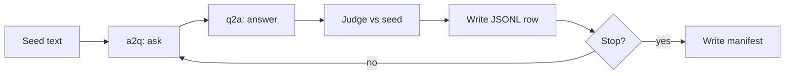

# echoChain

echoChain measures how an answer changes when models rewrite it in a loop.



## Install

```bash
pip install echochain
```

The optional `baseline` extra adds sentence-transformer scores:

```bash
pip install "echochain[baseline]"
```

Set `OPENROUTER_API_KEY` in the environment or in `.env`.

## Commands

Dry-run the packaged seed:

```bash
echochain run --config examples/echochain.toml --dry-run
```

Run one live cycle:

```bash
echochain run --start "Redis uses epoll for I/O" --max-cycles 1 --yes
```

Summarize a finished run:

```bash
echochain analyze runs/RUN_ID
```

Flags, configuration, output files, and exit codes are in the
[usage guide](https://github.com/smusali/echoChain/blob/main/docs/USAGE.md).

## Stability

Before 1.0.0, an incompatible change bumps the minor version and is listed in the
[changelog](https://github.com/smusali/echoChain/blob/main/docs/CHANGELOG.md).

## More

- [Methodology](https://github.com/smusali/echoChain/blob/main/docs/METHODOLOGY.md)
- [Contributing](https://github.com/smusali/echoChain/blob/main/docs/CONTRIBUTING.md)
- [Example config](https://github.com/smusali/echoChain/blob/main/examples/echochain.toml)
