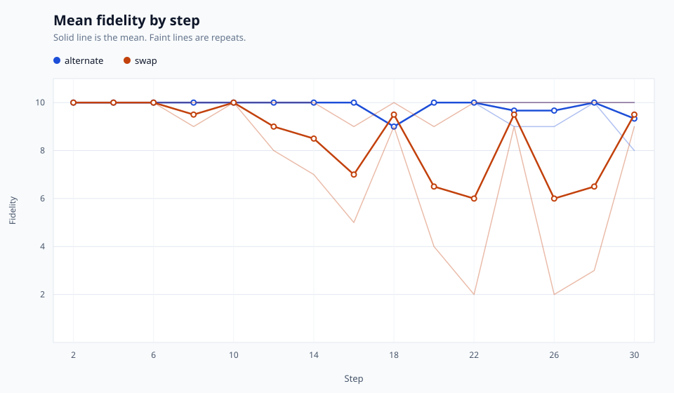

# echoChain 📞

[](https://github.com/smusali/echoChain/actions/workflows/ci.yml)
[](https://pypi.org/project/echochain/)
[](https://pypi.org/project/echochain/)

Research prototype. Runs write raw cycles to `runs/`.

echoChain passes a technical statement through a telephone-game chain of language models and records a judge score at each step ([`echochain/engine.py`](https://github.com/smusali/echoChain/blob/main/echochain/engine.py)). [Related work](#related-work) names the studies this follows and the differences in what it is built to measure.

## What is echoChain?

The loop starts from a technical statement, turns that statement into a question, turns the question back into an answer, and repeats. [`echochain/engine.py`](https://github.com/smusali/echoChain/blob/main/echochain/engine.py) runs the loop. Claim fidelity, the share of frozen claims the answer still supports, is the primary metric. A judge also gives a 1 to 5 anchored score and the existing 1 to 10 score. The measurement definition is in [`docs/METHODOLOGY.md`](docs/METHODOLOGY.md). The scores are not a human-validated measurement. [Related work](#related-work) names the studies this follows.

### The process

1. **Start** with a technical statement (for example, "Redis uses single-threaded event loops with epoll for I/O multiplexing").
2. **Transform** an answer into a question with the prompt in [`echochain/prompts/`](https://github.com/smusali/echoChain/blob/main/echochain/prompts).
3. **Transform** that question back into an answer with the other prompt in the same file.
4. **Repeat** for 30 steps ([`MAX_CYCLES`](https://github.com/smusali/echoChain/blob/main/echochain/config.py)). The run can also stop when spend hits `--budget`, a generation fails, judge failures exceed one tenth of the planned steps, or the process is interrupted. The manifest records that reason.
5. **Record** each cycle. The judge call is described under [Key features](#key-features).

### Example chain

The table below is an illustration of the loop. It is not a recorded experiment.

| Cycle | Phase | Content |
|-------|-------|---------|
| 0 | Seed | `Redis uses single-threaded event loops with epoll for I/O multiplexing` |
| 1 | a2q | `How does Redis achieve high concurrency without multiple threads?` |
| 2 | q2a | `Redis uses asynchronous I/O and an event-driven architecture` |
| 3 | a2q | `What techniques help Redis handle many connections efficiently?` |
| ... | ... | *[degradation continues]* |

## Quick start

### Prerequisites

- Python 3.11+. [CI](https://github.com/smusali/echoChain/blob/main/.github/workflows/ci.yml) tests 3.11 through 3.15 on Linux, macOS, and Windows.
- An OpenRouter API key for a live run ([get one here](https://openrouter.ai/)). `--help`, `--version`, and the test suite do not need a key.

### Installation

```bash
pip install echochain
```

The PyPI project name is `echochain`. That is the [PEP 503](https://peps.python.org/pep-0503/) form of `echoChain`.

[`.github/workflows/release.yml`](https://github.com/smusali/echoChain/blob/main/.github/workflows/release.yml) publishes each release with [Trusted Publishing](https://docs.pypi.org/trusted-publishers/). The workflow uses a GitHub OIDC token and stores no PyPI API token. Sigstore signs each distribution.

### Checkout

1. **Clone the repository**
   ```bash
   git clone https://github.com/smusali/echoChain.git
   cd echoChain
   ```

2. **Create a virtual environment**
   ```bash
   python -m venv .venv
   source .venv/bin/activate  # On Windows: .venv\Scripts\activate
   ```

3. **Install the package**
   ```bash
   pip install -e ".[dev]"
   ```
   For a pinned install, use `uv sync --frozen --extra dev` from the lock file. [CI](https://github.com/smusali/echoChain/blob/main/.github/workflows/ci.yml) uses that command.

4. **Configure the API key**

   echoChain reads `OPENROUTER_API_KEY` from the environment or from `.env` ([`load_api_key`](https://github.com/smusali/echoChain/blob/main/echochain/config.py)). It never accepts the key as a command-line argument ([`test_help_without_api_key`](https://github.com/smusali/echoChain/blob/main/tests/test_cli.py)).
   ```bash
   cp .env.example .env
   ```
   You can also export it in the shell:
   ```bash
   export OPENROUTER_API_KEY="your-api-key-here"
   ```
   `--help` and `--version` work without a key ([`test_help_without_api_key`](https://github.com/smusali/echoChain/blob/main/tests/test_cli.py), [`test_version_flag`](https://github.com/smusali/echoChain/blob/main/tests/test_cli.py)). A run without one exits with code 2 ([`test_missing_key_exits`](https://github.com/smusali/echoChain/blob/main/tests/test_cli.py)).

### Basic usage

```bash
# Run a single experiment
echochain --start "Redis uses single-threaded event loops with epoll for I/O multiplexing"

# The same entry point as a module
python -m echochain --start "Redis uses single-threaded event loops with epoll for I/O multiplexing"

# Stop once spend reaches 2 USD. The process exits with code 3.
echochain --budget 2 --start "Redis uses single-threaded event loops with epoll for I/O multiplexing"

# Run one corpus seed on the alternating schedule
echochain --seed redis-epoll

# Run the treatment and the three controls
echochain --seed redis-epoll --condition all

# Print the call count and cost bound, then exit
echochain --dry-run --split study --condition alternate --condition swap --condition same-model --repeats 3

# Write the run under a chosen root
echochain --out /tmp/echochain-runs --start "Redis uses single-threaded event loops with epoll for I/O multiplexing"

# Check results
ls runs/

# The same commands with the run subcommand
echochain run --seed redis-epoll

# Resolved settings, with the API key removed
echochain config show

# Check the configured models before a paid call
echochain models

# Curves, survival, the restricted mean up to max_cycles, and pairwise log-rank tests
echochain export --format csv runs/<run-directory>
echochain analyze runs/<run-directory>

# Continue an interrupted, failed, credit-stopped, or unfinished run
echochain run --resume RUN_ID

# Continue the unfinished cells of a batch
echochain run --resume BATCH_ID --out runs
```

`echochain --start` is `echochain run --start`. `--quiet` hides the per-step lines. `--verbose` adds token counts and cost to those lines. Every run ends with one line: the termination reason, the last recorded step, the planned length, and the run directory. A run that reaches the cycle cap also says where the low-score streak first completed, or that the threshold was not reached. Exit code 0 prints that line on stdout. Every other code prints it on stderr.

```text
max_cycles at step 30 of 30, threshold not reached: results saved to runs/<run>
```

The `echochain` command is [`echochain.cli:main`](https://github.com/smusali/echoChain/blob/main/echochain/cli.py). `python -m echochain` calls the same function from [`echochain/__main__.py`](https://github.com/smusali/echoChain/blob/main/echochain/__main__.py). A live run calls OpenRouter and spends money. Each run is a new directory named with a UTC timestamp and a UUID ([`mk_exp_dir`](https://github.com/smusali/echoChain/blob/main/echochain/persistence.py)). `--out` chooses the parent directory and defaults to `runs`. `--budget` is a USD cap. When spend reaches it, the process records `budget_exceeded` and exits with code 3. The same exit code is used when OpenRouter cannot reserve the call: the run records `insufficient_credits`.

## Configuration

Settings resolve in this order: CLI flags, then environment variables, then a TOML file, then the defaults in [`echochain/config.py`](https://github.com/smusali/echoChain/blob/main/echochain/config.py). [`examples/study.toml`](examples/study.toml) selects the study split, three conditions, and three repeats. Paths written in the file are relative to that file. Flag paths are relative to the working directory.

`echochain.toml` in the working directory is used when `--config` and `ECHOCHAIN_CONFIG` are unset. `echochain config show` prints the resolved JSON. It has no API-key field. The key stays in `OPENROUTER_API_KEY` or `.env`. A file that contains `api_key` is rejected.

`--model` may be repeated and replaces the whole rotating list. `--judge` may be repeated. `identity` stays at temperature 0. Every chat call sends `require_parameters: true` and `allow_fallbacks: false`. If the provider that would serve the call is unavailable, the run fails instead of moving to another provider. A pin is `model=provider,provider|false` and adds that order for one model. `|true` allows fallbacks for that model. In the TOML file a pin can also set `data_collection` to `"deny"` and `zdr` to true:

```toml
[providers."google/gemini-3.8-flash"]
order = ["google-vertex"]
allow_fallbacks = false
data_collection = "deny"
zdr = true
```

Those two fields are described under [Data handling](#data-handling).

Unknown keys, wrong types, and an empty model list exit with code 2. The message names the setting.

## Exit codes

| Code | Meaning |
|---|---|
| 0 | Completed, because the threshold or the cycle cap was reached |
| 1 | Runtime or API failure, including a generation or judge failure |
| 2 | Usage or configuration error |
| 3 | Budget exceeded, or the account could not reserve the call |
| 130 | Interrupted |

`echochain --help` lists the same codes.

## Cost and budgets

`--dry-run` prints the run count, the maximum call count, `tokens_upper_bound`, and `cost_upper_bound_usd`. It does not make a completion call. On a batch resume it counts and prices only the cells that are not finished, and a resumed cell is priced as a full cell. The token ceiling is the rendered prompt, or `max_tokens` for a later step's input, plus `max_tokens` for the completion, plus 16 tokens of chat framing. The cost ceiling uses the full prompt and completion prices from OpenRouter's model list, plus `pricing.request` when that field is present. Cache-read prices are not used. The list is fetched once per command and is not stored.

Without a key, or when a model has no price, the cost line is `unknown`. A known estimate above `confirm_above_usd` (default `$1`) does not start unless you pass `--yes`. `--dry-run` never asks for `--yes`. `--budget` still stops a run that is already in progress.

## Output

Each run creates a directory `runs/<UTC>_<run id>/`:

- `manifest.json`, written as soon as the run starts and replaced atomically when it finishes. `providers` lists each requested model with the provider that served it. `batch_id` and `repeat_index` name the cell inside a batch. An interrupt keeps `status` as `finished`, sets `termination_reason` to `interrupted`, and exits with code 130. A credit refusal that outlasts the waits also keeps `status` as `finished`, sets `termination_reason` to `insufficient_credits`, stores a one-line `error`, and exits with code 3. Any other catchable crash sets `status` to `failed` and stores a one-line `error`. A hard kill can still leave `status` as `running`, with each completed step already flushed to the JSONL.
- `chain.jsonl`, one UTF-8 object per step. The object carries the run id, phase (`a2q`, `q2a`, `identity`, or `paraphrase`), condition, schedule, `score_kind`, requested and served model, provider, input and output text, prompt hash, finish reason, sampling parameters, latency, tokens, cost, generation id, judge samples, a `baseline` object, and a UTC timestamp. An answer step stores claim fidelity, the 1 to 10 mean, and the 1 to 5 mean against the seed. From the second answer onward it also stores those comparisons against the previous answer. The baseline object stores the length ratio, technical-token survival, and the share of closed-class words. A pre-registered run also stores cosine and entailment against the seed, and against the previous answer from the second answer onward. A question step stores answerability on both scales and a baseline object whose values are null. A failed judge sample stores a null score and an error code. The manifest records the embedding and NLI revisions when those models ran, and the SHA-256 of the pre-registration file when one was set.

[`Recorder`](https://github.com/smusali/echoChain/blob/main/echochain/persistence.py) writes those files. [`test_fake_cycle_records_served_model`](https://github.com/smusali/echoChain/blob/main/tests/test_cli.py) reads them. The manifest's token and cost totals are the sum of the JSONL rows, including judge calls. Schemas for both documents are in `schemas/`.

`echochain export --format csv RUN` prints `cycle,phase,model,served_model,text,score` from that JSONL. A run does not write a CSV file.

`echochain run --resume RUN` continues one interrupted, failed, credit-stopped, or still-running run. `RUN` is the run directory, the run id under `--out`, or a batch id. The next step uses the last complete row's output, and the original seed is the first row's input. The condition, models, judge panel, stop rule, budget, and token cap come from the manifest. Provider pins and the API key come from the current configuration. Spend already recorded in the JSONL counts toward the budget. The low-score streak starts again. A run that finished for the threshold, the cycle cap, a generation failure, a judge failure, or the budget cannot be resumed. A single chain with no complete step cannot be resumed, because the manifest stores the seed hash and not the seed text.

A batch writes `<batch id>.batch.json` under `--out` before the first cell. Resuming that batch id skips cells whose manifest already finished for a closed reason, continues the credit-stopped or unfinished cell in the same directory, and starts cells that never ran. A credit stop with no completed step restarts at step 1 in that same directory, using the seed text saved in the batch file. `--dry-run` with the batch id does not start a run.

### Sample output

The rows below show the shape of `echochain export --format csv` and the current model IDs. They are not measurements from a run. The run directory does not contain this file.

```csv
cycle,phase,model,served_model,text,score
1,a2q,google/gemini-3.8-flash,google/gemini-3.8-flash,How does Redis handle concurrent requests?,8
2,q2a,deepseek/deepseek-v4.1-flash-1017,deepseek/deepseek-v4.1-flash-1017,Redis uses asynchronous I/O operations,7
3,a2q,mistralai/mistral-small-2603,mistralai/mistral-small-2603,What enables efficient I/O in databases?,5
```

`model` is the ID that was requested. `served_model` is the ID the provider returned. `echochain export` derives those columns from the JSONL, and [`test_fake_cycle_records_served_model`](https://github.com/smusali/echoChain/blob/main/tests/test_cli.py) compares them with the stored rows. Current IDs are [`ROTATING_MODELS`](https://github.com/smusali/echoChain/blob/main/echochain/config.py). Runs recorded with `google/gemini-2.0-flash-001` or `anthropic/claude-sonnet-4` cannot be reproduced. Those models have been retired. Current Claude Sonnet IDs are not in the rotation because the OpenRouter catalog does not advertise `seed` for them, and every configured model must advertise `response_format` and `seed` ([`check_models`](https://github.com/smusali/echoChain/blob/main/echochain/client.py), [`test_preflight_missing_seed`](https://github.com/smusali/echoChain/blob/main/tests/test_cli.py)).

## Architecture

```
echoChain/
├── echochain/           # Core package
│   ├── cli.py           # Command line
│   ├── design.py        # Schedules, conditions, and the seed corpus
│   ├── engine.py        # Telephone game orchestration
│   ├── client.py        # OpenRouter API communication
│   ├── judge.py         # Judge scoring
│   ├── baseline.py      # Length, token survival, cosine, and entailment
│   ├── analyze.py       # Curves, survival, restricted means, attractors, and agreement
│   ├── prompts/         # Versioned Jinja2 templates
│   ├── config.py        # Defaults, the experiment file, and the API key
│   └── persistence.py   # Manifest and JSONL output
├── examples/study.toml  # One study configuration
├── schemas/             # JSON Schemas for the manifest and JSONL rows
├── seeds/v1.toml        # Versioned seed corpus
├── tests/               # Offline tests
├── runs/                # Directories created by a run
├── CHANGELOG.md         # Release notes
└── pyproject.toml       # Package metadata
```

## Key features

- **Model rotation.** [`echochain/design.py`](https://github.com/smusali/echoChain/blob/main/echochain/design.py) assigns a model to each step. `alternate` walks [`ROTATING_MODELS`](https://github.com/smusali/echoChain/blob/main/echochain/config.py) one step at a time. `swap` walks that list backwards. `factorial` puts every model on every phase. `latin` balances models across the two phases. `fixed:<model>` uses one model for the whole chain. Every row records the schedule name. [`test_fake_cycle_records_served_model`](https://github.com/smusali/echoChain/blob/main/tests/test_cli.py) records the first ID and the served model.
- **Judge.** [`score`](https://github.com/smusali/echoChain/blob/main/echochain/judge.py) asks [`JUDGE_MODEL`](https://github.com/smusali/echoChain/blob/main/echochain/config.py) (`openai/gpt-4.1-mini`) for a JSON object with `rationale`, an integer `score` from 1 to 10, and an integer `anchored` score from 1 to 5. A fidelity call that has frozen claims also requires one verdict per claim. The request uses a strict JSON schema. The default is 3 samples at temperature 0.5. A reply that is empty, not an integer, outside that range, or missing a claim id is stored as no score. Too many of those failures end the run with `judge_error`. The stop rule still reads the 1 to 10 mean. Claim fidelity is the reported primary metric.
- **Run record.** [`Recorder.log`](https://github.com/smusali/echoChain/blob/main/echochain/persistence.py) appends the step to `chain.jsonl`. `echochain export --format csv` prints the short columns from that file. The same test reads the JSONL, the export, and the manifest totals.
- **Budget.** `--budget` stops the run after the call that reaches the cap. Tokens and cost come from the completion response.
- **Conditions.** `alternate` is the telephone chain with the alternating schedule. `swap` reverses that schedule. `same-model` keeps the telephone prompts and uses the first rotating model for every step. `identity` asks that model to repeat the text verbatim at temperature 0. `paraphrase` paraphrases the previous text with that model and does not turn it into a question. `--condition all` runs `alternate`, `same-model`, `identity`, and `paraphrase`.
- **Seeds.** [`seeds/v1.toml`](https://github.com/smusali/echoChain/blob/main/seeds/v1.toml) holds the statements, each with an id, a domain, a split (`study` or `held-out`), and a frozen claim list. `--seed` selects one id. `--split study` selects the study set. The manifest stores the seed id and the corpus file hash. An ad hoc `--start` text has no claims.

## Results

[`results/pilot-2026-10/`](results/pilot-2026-10/) holds the manifests, the raw JSONL, the plot script, and a short reading of the finished runs. The planned pilot was 10 study seeds, the `alternate`, `swap`, and `same-model` arms, and three repeats (90 runs, 5,400 calls). The dry-run upper bound was $14.05. Five runs finished and spent $0.15 before OpenRouter returned HTTP 402, because the account could not reserve the configured 1,024 completion tokens. The chart is that fragment: three `alternate` repeats and two `swap` repeats of the Redis seed.



### Full study

Run this only after `docs/PREREGISTRATION.md` is on the default branch. It calls OpenRouter and spends money. Install the baseline models first so cosine and entailment are recorded:

```bash
uv sync --extra dev --extra baseline
echochain --config examples/study.toml --dry-run
echochain run --config examples/study.toml --out runs --yes
```

Pass `--budget` with a USD cap. Resume a credit stop with `echochain run --resume BATCH_ID --config examples/study.toml`. Before treating the batch as the study, check that `git log -1 --format=%cI docs/PREREGISTRATION.md` is earlier than the first manifest `started_at`, and that `preregistration_sha256` matches the file.

Regenerate the figures from a fresh copy with `echochain analyze` on the archived run directories.

Write the results note only after the runs exist. Cover the implementation, the challenges, the design decisions, which model combinations degrade fastest and slowest, the average cycles to degradation, how many runs finished, and how generative AI was used.

Zenodo: enable the GitHub integration for `smusali/echoChain` before any future `v0.2.0` tag. It does not backfill `v0.1.0`. Deposit that release manually if the latest release needs a DOI before the next tag, then add the DOI to `CITATION.cff`. Deposit the study archive as its own Zenodo record and link it from this README.

Discussions:

```bash
gh api -X PATCH repos/smusali/echoChain -f has_discussions=true
```

Then add a contact link in `.github/ISSUE_TEMPLATE/config.yml`.

Labels: `gh label edit` for each custom label whose description is still empty, using the text in [CONTRIBUTING.md](CONTRIBUTING.md).

An optional timestamp of `docs/PREREGISTRATION.md` on OSF or AsPredicted is separate from the hash stored on the manifest.

## Related work

Iterative distortion through language models has already been studied. echoChain is built to differ in three ways:

1. **Technical claims.** A model can keep the topic and lose the mechanism. Frozen claims are the primary fidelity score. The 1 to 5 anchors and the 1 to 10 score are recorded beside them. Answer steps and question steps use different rubrics.
2. **Model rotation as a variable.** The schedule is named and stored on every row, and the control conditions separate a same-model chain, a verbatim round trip, and a direct paraphrase from the rotating telephone chain.
3. **Separate drift.** From the second answer onward, the judge also scores the answer against the previous answer. That comparison is stored apart from the comparison with the seed.

Cited work:

- Amr Mohamed, Mingmeng Geng, Michalis Vazirgiannis, and Guokan Shang. "LLM as a Broken Telephone: Iterative Generation Distorts Information." ACL 2025. DOI [10.18653/v1/2025.acl-long.371](https://doi.org/10.18653/v1/2025.acl-long.371). [Anthology](https://aclanthology.org/2025.acl-long.371/), [arXiv:2502.20258](https://arxiv.org/abs/2502.20258). Translation and paraphrase chains accumulate distortion. Restricted prompting and lower temperature reduce it and do not remove it.
- Jérémy Perez, Grgur Kovač, Corentin Léger, Cédric Colas, Gaia Molinaro, Maxime Derex, Pierre-Yves Oudeyer, and Clément Moulin-Frier. "When LLMs Play the Telephone Game: Cultural Attractors as Conceptual Tools to Evaluate LLMs in Multi-turn Settings." ICLR 2025. [arXiv:2407.04503](https://arxiv.org/abs/2407.04503). Introduces the attractor effect.
- Sabbir Mollah, Rohit Gupta, Sirnam Swetha, Qingyang Liu, Ahnaf Munir, and Mubarak Shah. "The Telephone Game: Evaluating Semantic Drift in Unified Models." 2025. [arXiv:2509.04438](https://arxiv.org/abs/2509.04438). Measures drift between images and text.
- Sewon Min, Kalpesh Krishna, Xinxi Lyu, Mike Lewis, Wen-tau Yih, Pang Wei Koh, Mohit Iyyer, Luke Zettlemoyer, and Hannaneh Hajishirzi. "FActScore: Fine-grained Atomic Evaluation of Factual Precision in Long Form Text Generation." EMNLP 2023. [Anthology](https://aclanthology.org/2023.emnlp-main.741/).
- A public tool that runs the same kind of chain: [yymss/llm-telephone](https://github.com/yymss/llm-telephone).

## Data handling

Every seed and every intermediate text is sent to OpenRouter, which routes the call to a third-party provider. The run directory stores those texts in `chain.jsonl`. Do not use a proprietary seed until you have checked the provider's data policy.

A pin can limit that routing:

- `data_collection = "deny"` uses only providers that do not collect user data.
- `zdr = true` uses only zero-data-retention endpoints.

OpenRouter can also enforce zero data retention for an account. If no provider accepts the pin, the call fails. The private vulnerability report path is [SECURITY.md](https://github.com/smusali/echoChain/blob/main/SECURITY.md).

## How to cite

Cite the software with [CITATION.cff](CITATION.cff):

```yaml
cff-version: 1.2.0
message: If you use this software, please cite it using these metadata.
title: echoChain
type: software
authors:
  - given-names: Samir
    family-names: Musali
    email: samir.musali@gmail.com
repository-code: https://github.com/smusali/echoChain
license: MIT
version: 0.1.0
date-released: 2026-10-25
```

The Zenodo DOI is not minted yet.

## Documentation

- [CONTRIBUTING.md](https://github.com/smusali/echoChain/blob/main/CONTRIBUTING.md): setup, offline tests, and the one paid smoke test
- [docs/METHODOLOGY.md](docs/METHODOLOGY.md): what a run measures
- [docs/PREREGISTRATION.md](docs/PREREGISTRATION.md): the frozen study design
- [CODE_OF_CONDUCT.md](CODE_OF_CONDUCT.md): Contributor Covenant 2.1
- [CITATION.cff](CITATION.cff): citation metadata
- [SECURITY.md](https://github.com/smusali/echoChain/blob/main/SECURITY.md): how to report a vulnerability privately
- [CHANGELOG.md](https://github.com/smusali/echoChain/blob/main/CHANGELOG.md): release notes
- [LICENSE](https://github.com/smusali/echoChain/blob/main/LICENSE): MIT License

## Contributing

See [CONTRIBUTING.md](https://github.com/smusali/echoChain/blob/main/CONTRIBUTING.md) for the development setup, the offline tests, and the pull request process.

## License

This project is licensed under the MIT License. See the [LICENSE](https://github.com/smusali/echoChain/blob/main/LICENSE) file for details.

## Acknowledgments

- Built for research into how language models preserve technical information.
- Uses [OpenRouter](https://openrouter.ai/) for access to the model APIs.
- Inspired by the telephone game, and by the studies in [Related work](#related-work).
