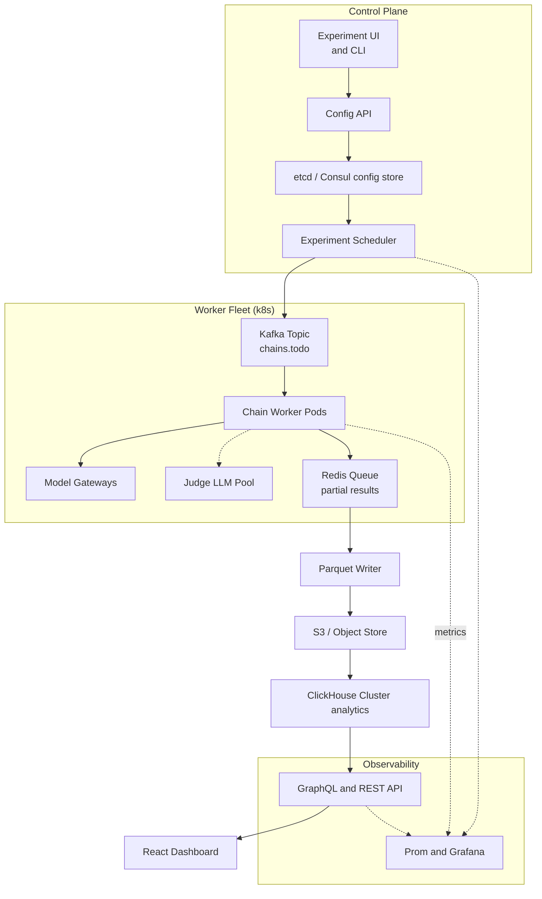

# LLM "Telephone-Game" Experiment Platform: System Design

*Scalable platform that runs **hundreds of thousands** of “answer→question→answer…” degradation chains per day, across a rotating pool of models, and serves live analytics.*

---

## Core Requirements

| Axis | Target |
|------|--------|
| **Volume** | ≥ 250 k chains/day × avg 12 hops → ≈ 3 M LLM calls |
| **Freshness** | Aggregates visible ≤ 10 min after chain completes |
| **Latency (analytics)** | p95 ≤ 150 ms for typical queries |
| **Budget** | ≤ $0.05 per full chain (model + judge fees) |
| **Fault tolerance** | Auto-retry ≤ 3 × with back-off; chain abort < 0.1 % |
| **Isolation** | Experiments sandboxed (no cross-contam data) |
| **Schema evolution** | Append-only + versioned for replayability |

---

## System Overview



---

## Control Plane

### Experiment Definition (YAML)

```yaml
id: "tx2code_2025Q3"
seed_answers:
  - "Redis uses single-threaded event loops with epoll for I/O multiplexing."
  - "Python’s GIL enforces ... "
modes:
  - text-to-code
models:
  pool:
    - gemini-2.0-flash
    - gpt-4o-mini
    - claude-4-sonnet
  rotation: round_robin   # supports weighted, epsilon-greedy
max_hops: 20
stop_threshold: score<=2
judge_model: gpt-4o-mini
priority: high
```

*Stored in Git → CI checks → POST to **Config API** → versioned in **etcd** (key `/experiments/<id>/<semver>`).*
*Why etcd?* Fast watch streams; atomic compare-and-swap for live edits.

### Scheduler

* Watches `/experiments/*` for new or updated configs.
* Calculates total chains = `|seeds| × daily_repeats`.
* Splits into **chain manifests** (JSON) of ≤ 200 hops each (keep worker CPU-bound).
* Publishes to **Kafka `chains.todo`** with keys `experiment_id::seed_hash` (enables ordered retries).

---

## Worker Execution Model

| Step | Action                                                        | Notes                            |
| ---- | ------------------------------------------------------------- | -------------------------------- |
| 0    | Pull manifest from Kafka (`chains.todo`)                      | Commit offset after success      |
| 1    | For each hop: pick next model via **Rotation Strategy**       | Strategy deterministic per chain |
| 2    | Call model gateway (OpenRouter)                               | Timeout 30 s                     |
| 3    | After hop: call **Judge Pool** to score (vs. hop 0 answer)    | Batched 16 pairs/call            |
| 4    | Stream partial result to **Redis Queue** (`hash::<chain_id>`) | Fire-and-forget O(1)             |
| 5    | If score ≤ threshold OR hop == `max_hops` → mark **DONE**     | Push summary record              |
| 6    | Ack Kafka offset                                              |                                  |

*Workers are **stateless** pods (Go binary).*
*Why Redis for partials?* µsecond writes, suitable for high-fan-out; easy expiry (`EX` 7 days).

### Failure / Retry

* **Transient error** (HTTP 429/502): exponential back-off (1 → 8 s) max 3.
* **Permanent**: mark hop error, continue chain; final score = `min(scores)`.
* **Pod crash**: offset not committed → Kafka re-delivers (exact-once semantics w/ idempotent writes).

---

## Result Materialization Path

1. **Redis Stream Consumer** (`parquet-sink`) reads partials in micro-batches (5 s or 10 k records).
2. Writes **Parquet** files to `/experiments/<id>/date=YYYY-MM-DD/hour=HH/*.parquet` on **S3**.
3. **ClickHouse `s3Cluster()` engine** auto-detects new parts every 1 min; `INSERT SELECT` moves into hot SSD table.

*Why Parquet on S3?*

* Cheap durable staging, columnar compression → 6 × storage savings.
* Decouples hot write path from analytics DB → eliminates write-locks.

---

## Analytics and Query Layer

### Schema

```sql
CREATE TABLE chains
(
  experiment_id LowCardinality(String),
  chain_id UUID,
  hop UInt8,
  model_id LowCardinality(String),
  prompt String,
  response String,
  judge_score Float32,
  latency_ms UInt16,
  ts DateTime
) ENGINE = MergeTree()
PARTITION BY toYYYYMMDD(ts)
ORDER BY (experiment_id, chain_id, hop);
```

*Indexes on `(experiment_id, hop)` to serve common aggregates.*

### Pre-Aggregated Views

| View           | Purpose                                         |
| -------------- | ----------------------------------------------- |
| `deg_curve_mv` | Average score per hop per `experiment_id, mode` |
| `cost_mv`      | \$ spent per model per 1 h window               |
| `latency_mv`   | p50/p95 lat per model per hop                   |

Materialized every 2 min via ClickHouse **materialized view** + **TumblingWindow**.

### API

* **GraphQL** for flexible analytics (`hopRange`, `mode`, `modelFilter`).
* **REST** shortcuts:

  * `GET /experiments/<id>/curve`
  * `GET /models/top?metric=avg_final_score`

**Cache**: CloudFront 30 s TTL if query not filtered by `ts>` (hot path).

---

## Mitigating Write-Heavy vs Read-Heavy Contention

1. **Staging → Bulk insert** pattern (Parquet → hourly batches) avoids row-by-row writes.
2. **ClickHouse hot/cold tiering**:

   * Hot 3-day data on NVMe; cold on S3.
3. **Worker cluster uses Redis, not DB**, for intermediate state → isolates spike writes.
4. **Kafka topic partitions** = `num_workers × 3` ensures balanced consumption.
5. **Read replicas**: ClickHouse asynchronous replicate to **`replica_ro`** nodes used by API/dashboards.
6. **Query governor**: Kill queries > 30 s or reading > 5 GiB; dashboards use `LIMIT 10 k`.

---

## Cost Controls

| Lever                   | Detail                                                                    |
| ----------------------- | ------------------------------------------------------------------------- |
| **Spot instances**      | 85 % of worker pods on spot; fallback on-demand if backlog > 30 min       |
| **Token cap per chain** | Hard cap 3 k tokens; if exceeded, truncate                                |
| **Judge pooling**       | Batch 16 comparisons → 35 % cost cut                                      |
| **Dynamic stop**        | If score plateaus (Δ < 0.5 for 3 hops), early-stop                        |
| **Off-peak scheduling** | Low-priority experiments throttled during daytime to cheaper night window |

---

## P8: Failure Handling and Resilience

| Area               | Picked                                       | Alternative      | Reason                                   |
| ------------------ | -------------------------------------------- | ---------------- | ---------------------------------------- |
| **Kafka**          | At-least-once, scalable, offset-based replay | SQS              | Higher throughput, partition ordering    |
| **Redis Streams**  | Micro-buffer for partials                    | Direct DB insert | Decouples hotspot ingestion from OLAP DB |
| **ClickHouse**     | Low-lat OLAP, cost-free queries              | BigQuery         | No per-query cost; on-prem deploy option |
| **Golang workers** | Memory-light, fast                           | Python           | 2-3× CPU usage under load                |
| **GraphQL + REST** | Flexible + simple                            | SQL over HTTP    | Hide schema, enforce ACLs                |
| **etcd config**    | Atomic watch/notify                          | Relational DB    | Lower latency, native k8s ops            |

---

## Anticipated Follow-Up Discussion

<details>
<summary>🔄 *How to rotate model pool daily?*</summary>

*Update `models.pool` list → commit → Scheduler sees **etcd watch event** → new chains use updated pool; running chains unaffected for determinism.*

</details>

<details>
<summary>🧨 *What if Judge LLM starts rate-limiting?*</summary>

*Workers place judge tasks on dedicated **`judge.todo`** Kafka; fallback judge model list; scheduler escalates to slower offline judge once backlog > 10 min.*

</details>

<details>
<summary>📈 *Scaling to 10 M chains/day?*</summary>

1. Increase Kafka partitions × 4.
2. Add worker namespace in second region; MirrorMaker2 federates topics.
3. Split ClickHouse cluster shards by `experiment_id` hash (consistent hashing).
4. Promotion of S3 staging from hourly → 15 min buckets to keep freshness.

</details>

---

## Conclusion

The proposed platform separates *control* (etcd + scheduler) from *data* (Kafka → Redis → Parquet → ClickHouse), enabling massive write throughput without throttling interactive reads, while staying cost-efficient and fault-tolerant—perfectly aligned with Not Diamond’s need for rapid experiment iteration at LLM scale.
