# LLM "Telephone-Game" Experiment Platform: System Design

## Problem Statement

The LLM "telephone game" experiment measures how information degrades as it passes through chains of LLM transformations. This is crucial for understanding:
- Information preservation across different model combinations
- Degradation patterns in specific domains (text-to-code, summarization, translation)
- Model performance characteristics in multi-hop scenarios
- Quality assessment for complex AI pipelines

We need a platform that can run hundreds of thousands of these experiments daily across a rotating pool of models, with near-real-time analytics and interactive querying capabilities. The system must handle write-heavy ingestion from experiment execution while providing read-heavy analytics without performance degradation.

## P2: Requirements Analysis

### Functional Requirements
- Define and manage experiment configurations (chain length, model pools, prompts)
- Execute information-degradation chains across multiple LLM models
- Track degradation metrics at each step (semantic similarity, factual accuracy, etc.)
- Provide near-real-time analytics and interactive querying
- Support experiment versioning and A/B testing
- Enable custom degradation metrics and evaluation criteria

### Non-Functional Requirements
- **Throughput**: 100,000+ experiment chains per day
- **Latency**: <5 minutes for experiment completion, <100ms for analytics queries
- **Availability**: 99.9% uptime for experiment execution and analytics
- **Scalability**: Horizontal scaling for both execution and analytics
- **Data Freshness**: <1 minute delay for analytics after experiment completion
- **Cost Efficiency**: Optimize LLM API usage and infrastructure costs

## P3: Architecture Evolution

### Phase 1: Basic Experiment Execution

We start with a simple single-region system that can handle basic experiment execution:

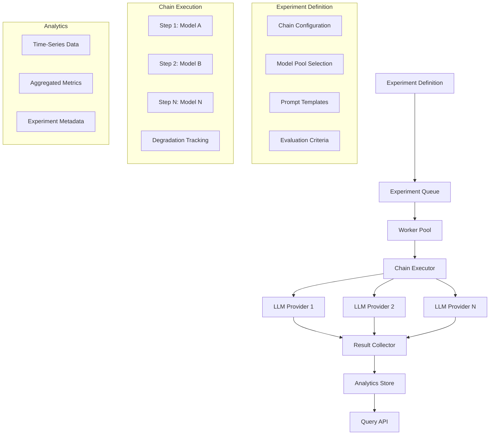

**Why this approach?** Simple architecture that establishes the core concepts: experiment definition, chain execution, and basic analytics. We can validate the concept before adding complexity.

**Why not distributed execution initially?** Single-region simplifies debugging, reduces latency for initial experiments, and allows us to optimize the core execution logic before scaling.

### Phase 2: Advanced Experiment Management and Analytics

As we scale, we need sophisticated experiment management and real-time analytics:

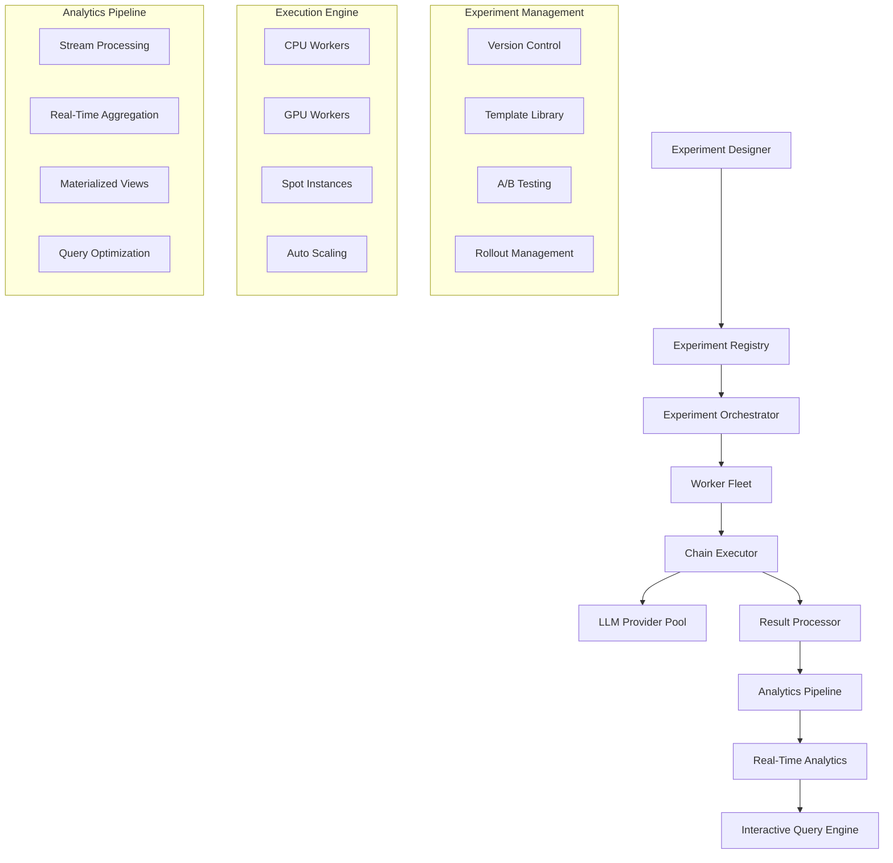

**Key Additions:**
- **Experiment Registry**: Centralized management of experiment configurations
- **Worker Fleet**: Distributed execution across multiple worker types
- **Analytics Pipeline**: Real-time processing of experiment results
- **Interactive Query Engine**: Fast querying of aggregated results

**Why these components?**
- **Experiment Registry** enables experiment reuse and versioning
- **Worker Fleet** provides scalability and cost optimization
- **Analytics Pipeline** enables real-time insights
- **Query Engine** supports interactive exploration of results

### Phase 3: Global Scale with Advanced Analytics

Now we scale globally with sophisticated analytics and partitioning:

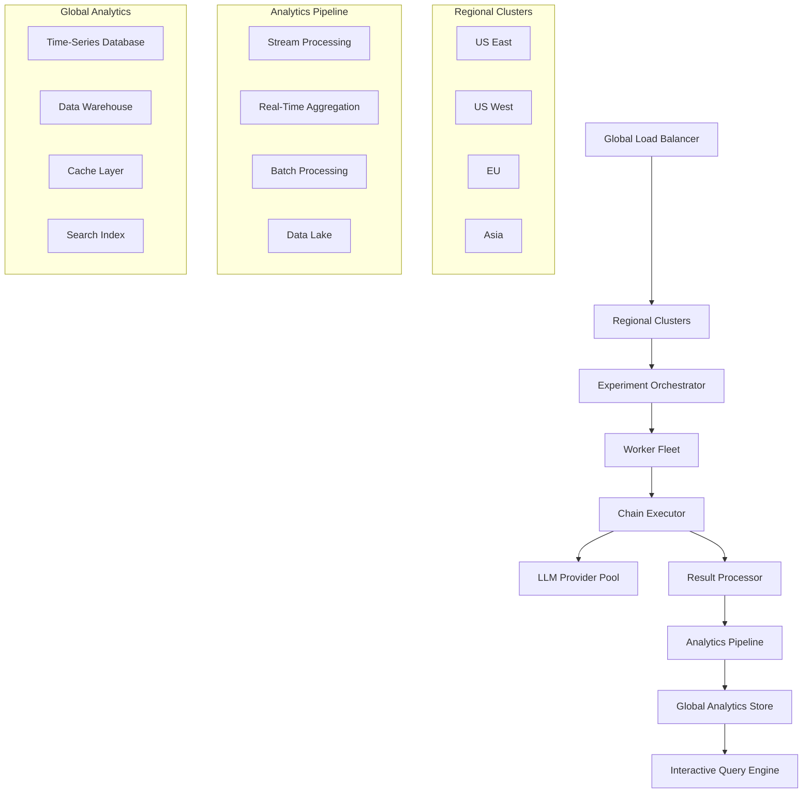

**Global Scale Benefits:**
- **Geographic Distribution**: Reduce latency for global LLM providers
- **Fault Tolerance**: Continue operation if some regions fail
- **Cost Optimization**: Use region-specific pricing and spot instances
- **Data Locality**: Store analytics close to execution for performance

## P4: Detailed Architecture

### Core Components

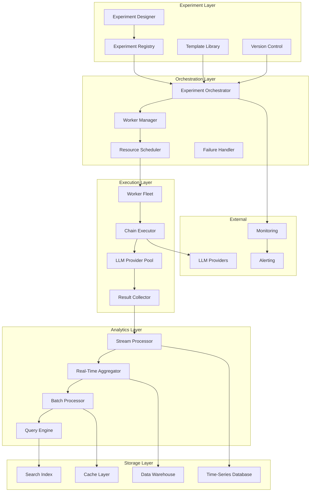

### Experiment Definition System

**Experiment Configuration Schema:**
```yaml
experiment:
  id: "text-to-code-degradation-v1"
  version: "1.2.0"
  description: "Measure information degradation in text-to-code chains"
  
  chain_config:
    length: 5
    model_pool: ["gpt-4", "claude-3", "gemini-pro"]
    selection_strategy: "round_robin"
    max_retries: 3
    
  prompt_template:
    initial: "Convert this text to Python code: {input}"
    intermediate: "Convert this code to {target_language}: {input}"
    final: "Explain what this code does: {input}"
    
  evaluation_criteria:
    - type: "semantic_similarity"
      threshold: 0.7
      model: "sentence-transformers"
    - type: "code_execution"
      timeout: 30
      environment: "python-3.9"
    - type: "factual_accuracy"
      reference_data: "ground_truth.json"
    
  sampling:
    input_size: 1000
    batch_size: 50
    priority: "high"
    
  analytics:
    real_time_metrics: ["degradation_curve", "model_performance"]
    aggregation_windows: ["1m", "5m", "1h", "1d"]
    retention_policy: "30_days_hot_90_days_warm"
```

**Experiment Lifecycle:**
1. **Design**: Create experiment configuration with templates
2. **Validate**: Test configuration with sample data
3. **Deploy**: Roll out to production with gradual traffic
4. **Monitor**: Track execution metrics and results
5. **Analyze**: Generate insights and visualizations
6. **Iterate**: Refine based on findings

### Worker Execution Model

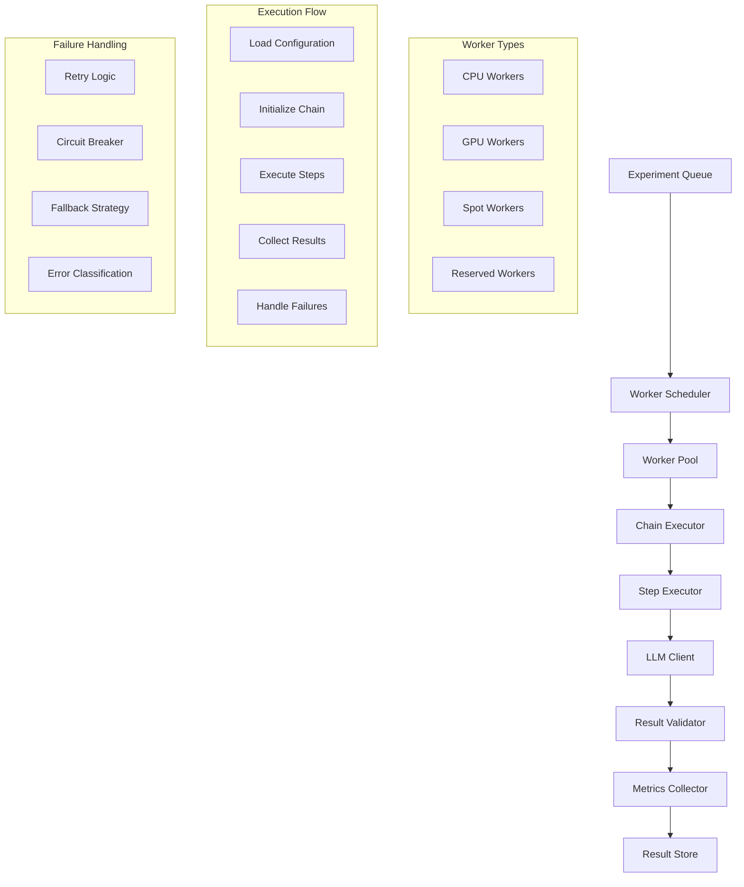

**Worker Execution Strategy:**
- **CPU Workers**: Handle lightweight chains and preprocessing
- **GPU Workers**: Execute compute-intensive evaluations
- **Spot Workers**: Use for cost optimization on non-critical experiments
- **Reserved Workers**: Ensure capacity for high-priority experiments

**Execution Flow:**
1. **Configuration Loading**: Load experiment config and templates
2. **Chain Initialization**: Set up execution environment and dependencies
3. **Step Execution**: Execute each step in the chain with proper error handling
4. **Result Collection**: Gather metrics and validate results
5. **Failure Handling**: Implement retry logic and fallback strategies

### Failure and Retry Policy

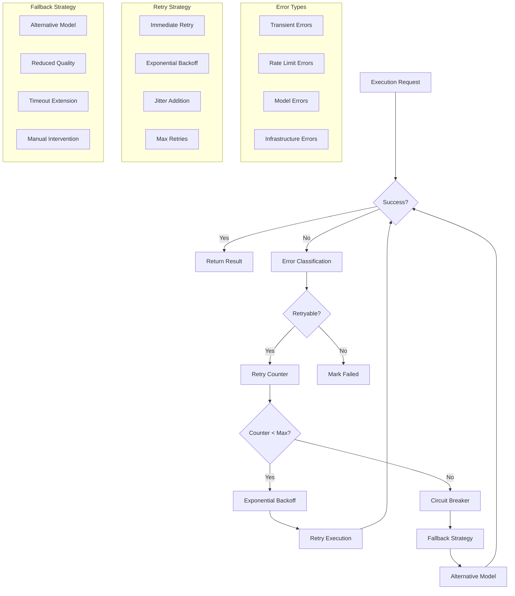

**Retry Policy:**
- **Immediate Retry**: For transient network errors (max 2 attempts)
- **Exponential Backoff**: For rate limits and temporary failures (max 5 attempts)
- **Circuit Breaker**: Stop retrying if failure rate exceeds threshold
- **Fallback Strategy**: Use alternative models or reduced quality settings

**Error Classification:**
- **Transient**: Network timeouts, temporary unavailability
- **Rate Limit**: API quota exceeded, temporary throttling
- **Model Error**: Invalid input, model-specific failures
- **Infrastructure**: Worker crashes, resource exhaustion

### Result Materialization

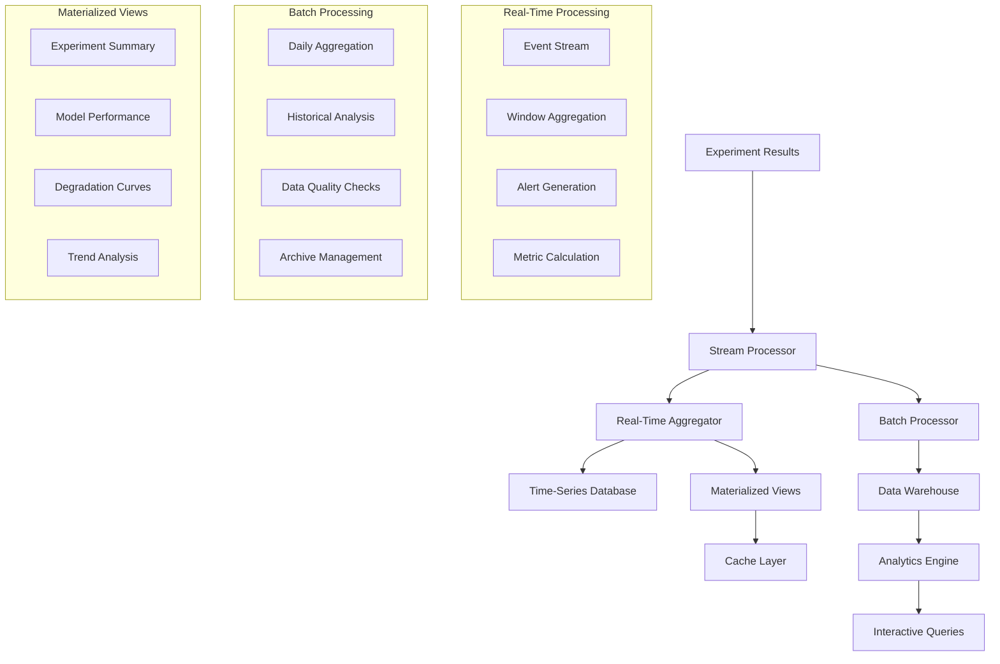

**Materialization Strategy:**
- **Real-Time**: Stream processing for immediate insights
- **Near-Real-Time**: 1-5 minute delay for complex aggregations
- **Batch**: Daily processing for historical analysis
- **Materialized Views**: Pre-computed aggregations for fast queries

**Data Flow:**
1. **Stream Processing**: Process results as they arrive
2. **Real-Time Aggregation**: Calculate metrics in sliding windows
3. **Batch Processing**: Perform complex aggregations and analysis
4. **Materialized Views**: Pre-compute common query patterns

## P5: Scaling Strategy

### Storage Schema

```mermaid
erDiagram
    EXPERIMENT {
        string experiment_id PK
        string version
        json configuration
        timestamp created_at
        timestamp updated_at
        string status
        integer priority
    }
    
    EXPERIMENT_EXECUTION {
        string execution_id PK
        string experiment_id FK
        string chain_id
        timestamp started_at
        timestamp completed_at
        string status
        json results
        integer step_count
        float total_cost
    }
    
    CHAIN_STEP {
        string step_id PK
        string execution_id FK
        integer step_number
        string model_used
        string input_text
        string output_text
        float latency_ms
        float cost_usd
        json metrics
        timestamp executed_at
    }
    
    DEGRADATION_METRIC {
        string metric_id PK
        string execution_id FK
        string metric_type
        float value
        json metadata
        timestamp calculated_at
    }
    
    EXPERIMENT ||--o{ EXPERIMENT_EXECUTION
    EXPERIMENT_EXECUTION ||--o{ CHAIN_STEP
    EXPERIMENT_EXECUTION ||--o{ DEGRADATION_METRIC
```

**Database Design:**
- **Time-Series Database**: Store high-frequency metrics and real-time data
- **Data Warehouse**: Store historical data and complex aggregations
- **Cache Layer**: Store frequently accessed materialized views
- **Search Index**: Enable full-text search across experiment metadata

### Partitioning Strategy

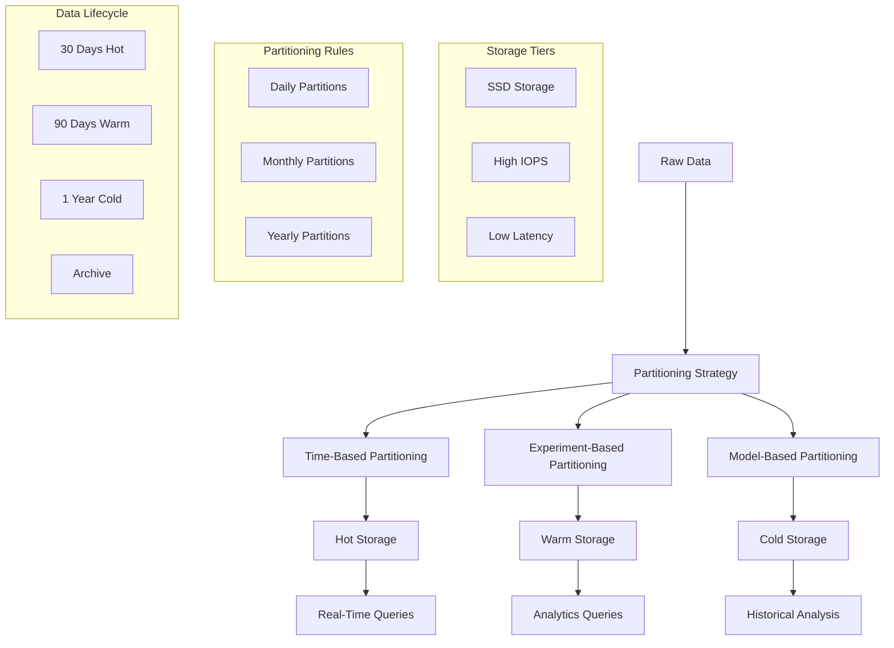

**Partitioning Strategy:**
- **Time-Based**: Partition by date for efficient time-range queries
- **Experiment-Based**: Partition by experiment ID for experiment-specific analysis
- **Model-Based**: Partition by model for model performance analysis

**Storage Tiers:**
- **Hot Storage**: Recent data (last 30 days) on fast storage
- **Warm Storage**: Older data (30-90 days) on standard storage
- **Cold Storage**: Historical data (90+ days) on cost-effective storage

## Interactive Query Layer

### Query Architecture

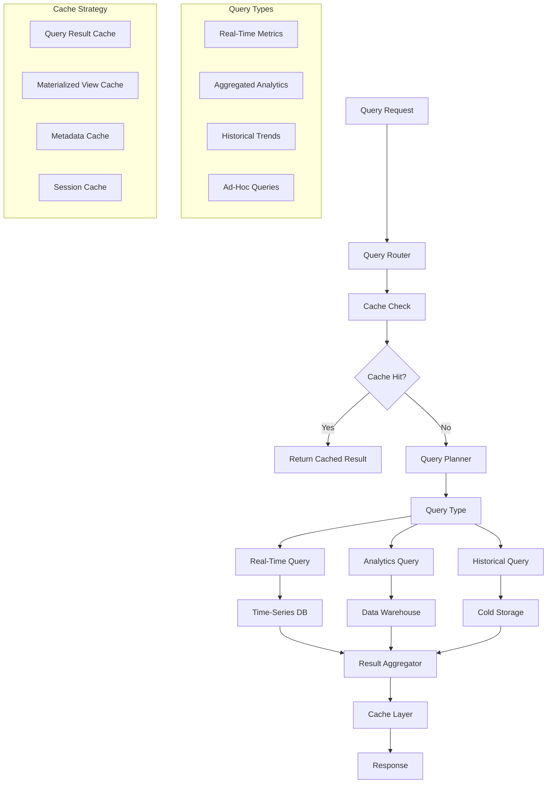

**Query Types:**
- **Real-Time Queries**: Current experiment status and metrics
- **Analytics Queries**: Aggregated performance and trends
- **Historical Queries**: Long-term analysis and comparisons
- **Ad-Hoc Queries**: Custom analysis and exploration

**Query Optimization:**
- **Query Caching**: Cache frequently accessed results
- **Materialized Views**: Pre-compute common aggregations
- **Query Planning**: Optimize query execution based on data distribution
- **Indexing**: Create indexes for common query patterns

### Example Queries

**Real-Time Experiment Status:**
```sql
SELECT 
    experiment_id,
    COUNT(*) as active_chains,
    AVG(completion_time) as avg_completion_time,
    SUM(total_cost) as total_cost
FROM experiment_executions 
WHERE status = 'running' 
    AND started_at >= NOW() - INTERVAL '1 hour'
GROUP BY experiment_id;
```

**Degradation Curve Analysis:**
```sql
SELECT 
    step_number,
    AVG(degradation_score) as avg_degradation,
    STDDEV(degradation_score) as degradation_std,
    COUNT(*) as sample_count
FROM degradation_metrics dm
JOIN chain_steps cs ON dm.execution_id = cs.execution_id
WHERE dm.metric_type = 'semantic_similarity'
    AND cs.executed_at >= NOW() - INTERVAL '24 hours'
GROUP BY step_number
ORDER BY step_number;
```

**Model Performance Comparison:**
```sql
SELECT 
    model_used,
    AVG(latency_ms) as avg_latency,
    AVG(cost_usd) as avg_cost,
    COUNT(*) as total_executions,
    AVG(degradation_score) as avg_degradation
FROM chain_steps cs
JOIN degradation_metrics dm ON cs.execution_id = dm.execution_id
WHERE cs.executed_at >= NOW() - INTERVAL '7 days'
GROUP BY model_used
ORDER BY avg_degradation DESC;
```

## P5: Scaling Strategy

### Horizontal Scaling

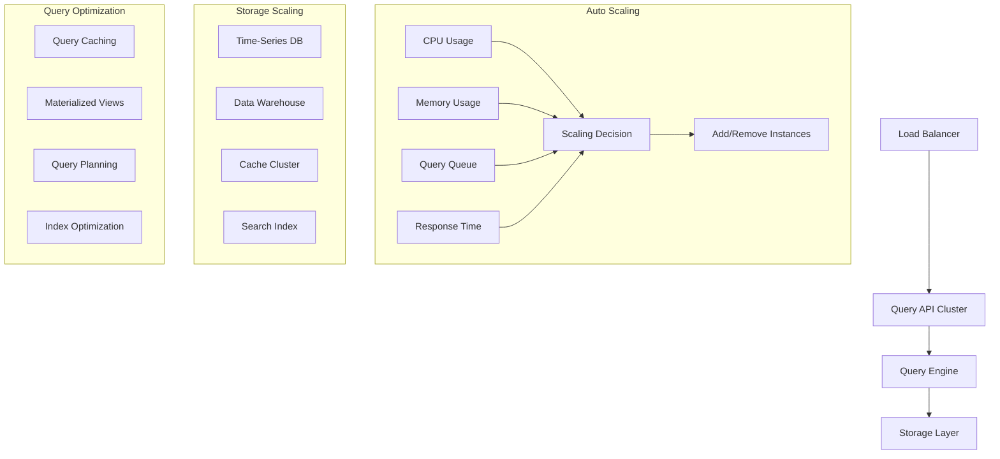

**Scaling Triggers:**
- **CPU Utilization**: Scale when >70% for 5 minutes
- **Memory Usage**: Scale when >80% for 3 minutes
- **Query Queue Length**: Scale when >100 queries waiting
- **Response Time**: Scale when p95 >100ms for 5 minutes

### Write-Heavy vs Read-Heavy Optimization

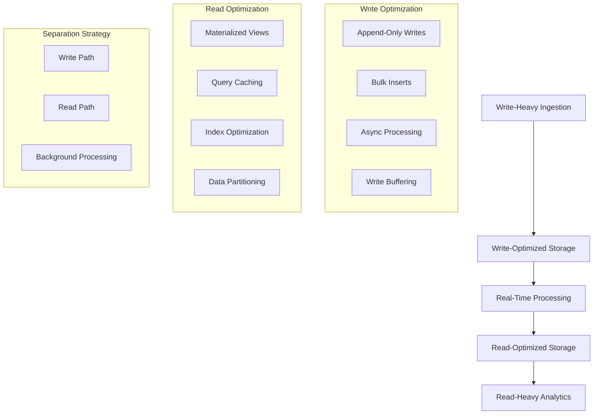

**Write-Heavy Optimization:**
- **Append-Only Writes**: Minimize write amplification
- **Bulk Inserts**: Batch multiple writes together
- **Async Processing**: Process writes asynchronously
- **Write Buffering**: Buffer writes to reduce I/O

**Read-Heavy Optimization:**
- **Materialized Views**: Pre-compute common aggregations
- **Query Caching**: Cache frequently accessed results
- **Index Optimization**: Create indexes for common queries
- **Data Partitioning**: Partition data for efficient queries

## P6: Monitoring and Observability

### Metrics and Alerting

```mermaid
graph TD
    A[Experiment Metrics] --> B[Prometheus]
    C[Execution Metrics] --> D[InfluxDB]
    E[Query Metrics] --> F[Grafana]
    
    B --> G[Alerting Engine]
    D --> G
    F --> G
    
    G --> H[PagerDuty]
    G --> I[Slack]
    G --> J[Email]
    
    subgraph "Key Metrics"
        K1[Experiment Success Rate]
        K2[Execution Latency]
        K3[Query Response Time]
        K4[Cost Per Experiment]
        K5[Data Freshness]
        K6[Cache Hit Rate]
    end
    
    subgraph "Alerting Rules"
        L1[Success Rate < 95%]
        L2[Latency > 5 minutes]
        L3[Query Time > 100ms]
        L4[Cost > Budget]
        L5[Data Delay > 1 minute]
    end
```

**Key Metrics:**
- **Experiment Success Rate**: Track successful vs failed experiments
- **Execution Latency**: Monitor experiment completion time
- **Query Response Time**: Ensure fast analytics queries
- **Cost Per Experiment**: Track and optimize costs
- **Data Freshness**: Monitor delay between execution and analytics
- **Cache Hit Rate**: Optimize query performance

## P10: Follow-up Questions and Answers

### Q: How do you handle experiment versioning and rollbacks?

**A:** Comprehensive versioning strategy:
1. **Immutable Versions**: Each experiment version is immutable once created
2. **Gradual Rollout**: Deploy new versions with traffic splitting
3. **A/B Testing**: Compare versions side-by-side before full rollout
4. **Rollback Mechanism**: Quick rollback to previous version if issues arise
5. **Version Compatibility**: Ensure backward compatibility for data analysis

### Q: How do you ensure data consistency across distributed execution?

**A:** Multi-layered consistency approach:
1. **Event Sourcing**: Use event logs for audit trail and consistency
2. **Idempotent Operations**: Make all operations idempotent for safe retries
3. **Distributed Transactions**: Use saga pattern for complex multi-step operations
4. **Eventual Consistency**: Accept eventual consistency for analytics queries
5. **Conflict Resolution**: Implement conflict resolution for concurrent updates

### Q: How do you optimize costs for hundreds of thousands of experiments?

**A:** Aggressive cost optimization:
1. **Spot Instances**: Use spot instances for 70% of worker capacity
2. **Model Selection**: Choose cost-effective models for non-critical experiments
3. **Batch Processing**: Group similar experiments to maximize efficiency
4. **Caching**: Cache LLM responses to avoid duplicate API calls
5. **Budget Controls**: Implement per-experiment and global budget limits

### Q: How do you handle the cold start problem for new experiments?

**A:** Efficient cold start strategy:
1. **Warm Pools**: Maintain warm worker pools for common experiment types
2. **Preloading**: Pre-load experiment configurations and templates
3. **Predictive Scaling**: Scale resources based on experiment queue length
4. **Resource Pooling**: Share resources across similar experiments
5. **Gradual Ramp-up**: Start with small batches and scale up

### Q: How do you ensure experiment reproducibility?

**A:** Rigorous reproducibility measures:
1. **Deterministic Execution**: Use fixed random seeds and deterministic algorithms
2. **Environment Isolation**: Isolate experiment execution environments
3. **Version Pinning**: Pin all dependencies and model versions
4. **Artifact Storage**: Store all inputs, outputs, and intermediate results
5. **Audit Logging**: Comprehensive logging of all execution steps

### Q: How do you handle experiments with different resource requirements?

**A:** Dynamic resource allocation:
1. **Resource Classification**: Categorize experiments by resource needs
2. **Worker Specialization**: Specialize workers for different experiment types
3. **Dynamic Scheduling**: Schedule experiments based on available resources
4. **Resource Reservation**: Reserve resources for high-priority experiments
5. **Auto Scaling**: Scale resources based on experiment requirements

## Conclusion

The LLM "Telephone-Game" Experiment Platform provides a comprehensive solution for running large-scale information degradation experiments. By combining sophisticated experiment management, distributed execution, real-time analytics, and optimized storage, we create a system that:

- **Scales Efficiently**: Handles hundreds of thousands of experiments daily
- **Provides Insights**: Real-time analytics and interactive querying
- **Optimizes Costs**: Efficient resource usage and cost controls
- **Ensures Reliability**: Robust failure handling and data consistency
- **Enables Innovation**: Flexible experiment definition and versioning

The architecture prioritizes production readiness, cost efficiency, and scalability while maintaining the flexibility to support diverse experiment types and analysis requirements. The system is designed to evolve with the rapidly changing LLM landscape and provide continuous value for understanding information degradation patterns. 