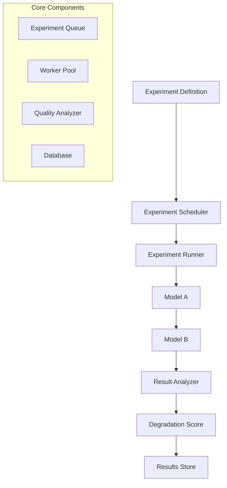
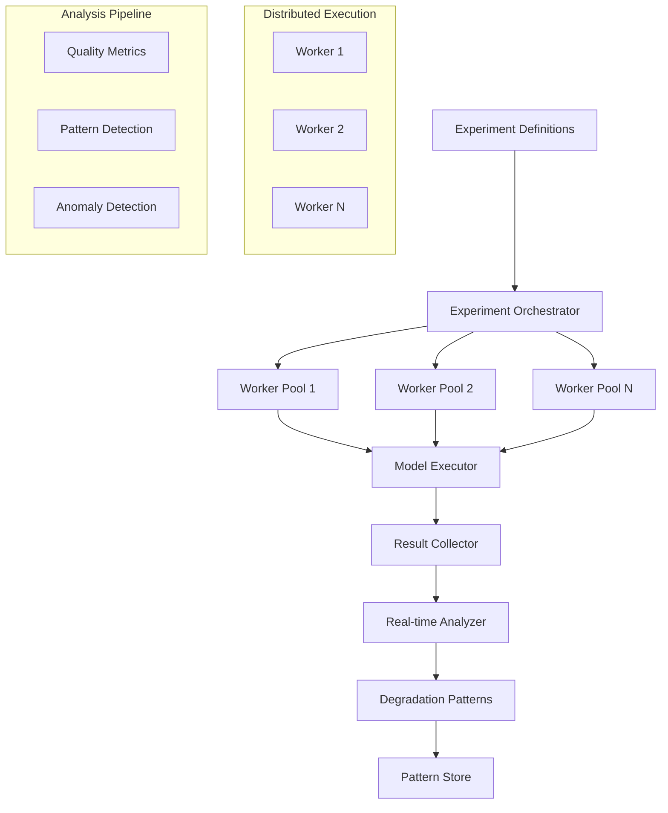
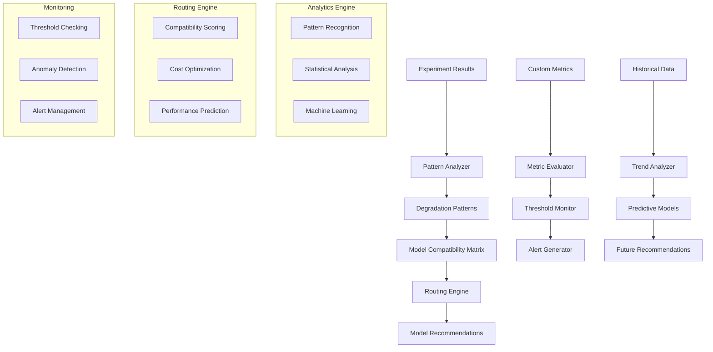
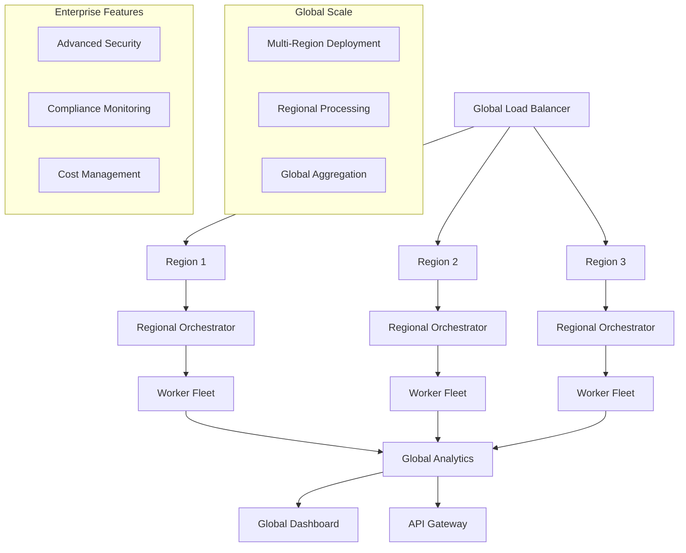
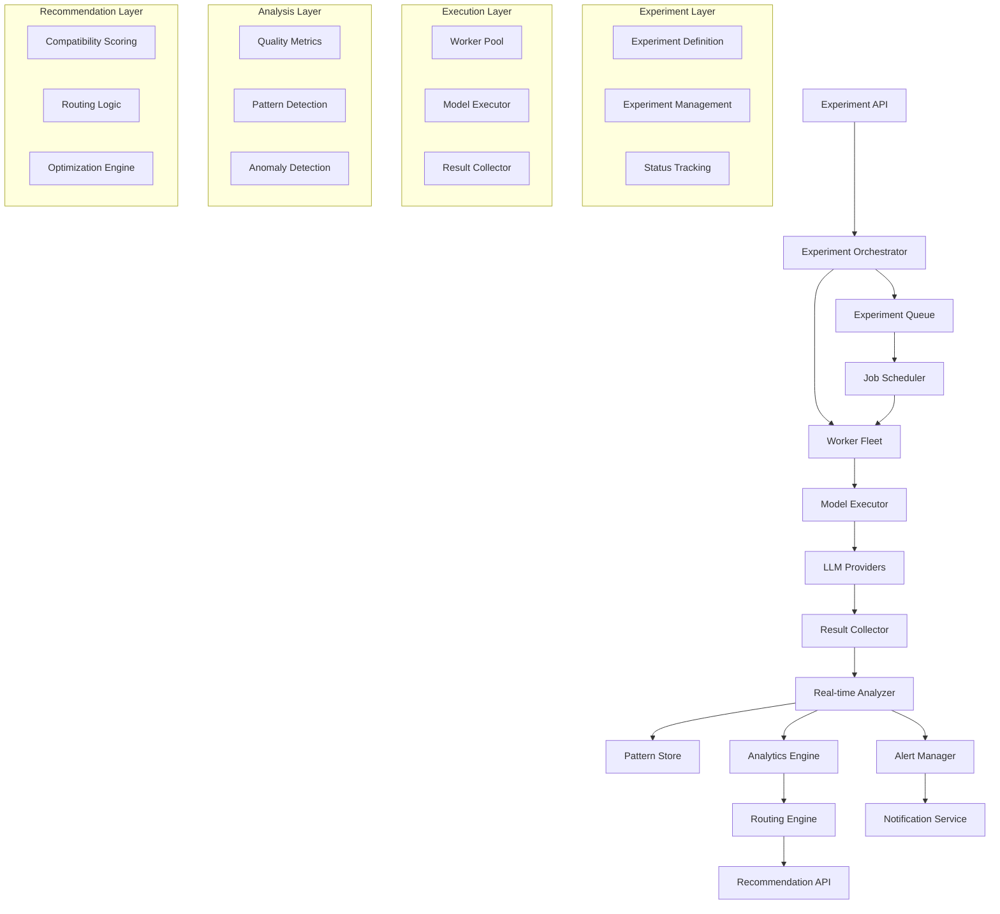
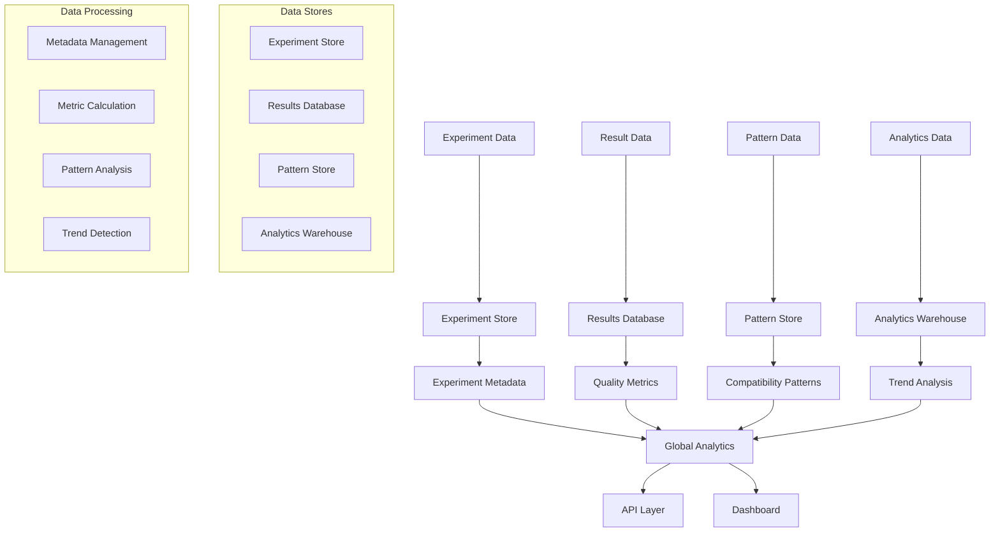
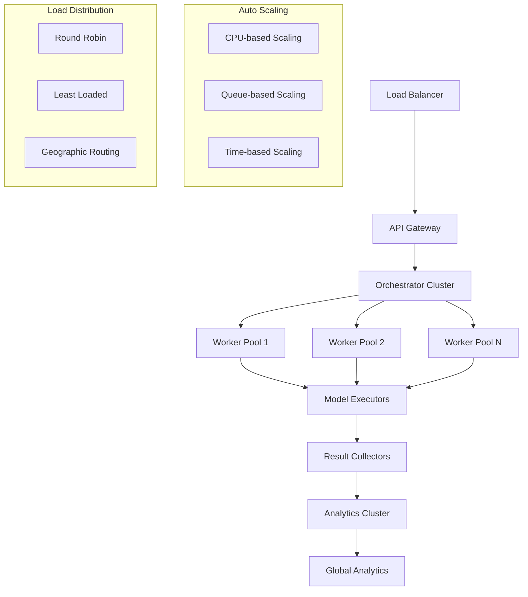
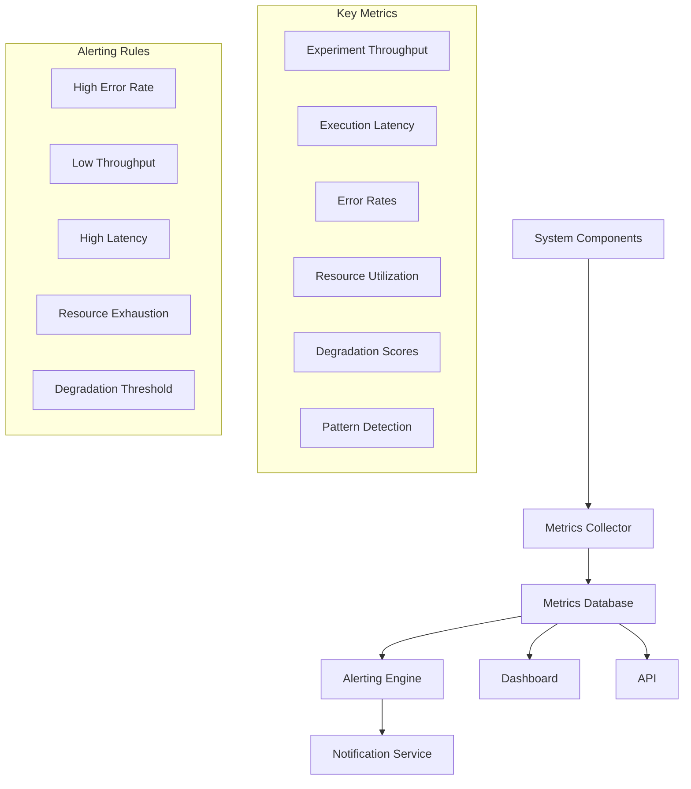

# Model Degradation Analysis Pipeline: System Design

## Problem Statement

Understanding how information degrades when passed through different model combinations is crucial for building reliable AI systems. The goal is to design a distributed system that:

- Runs thousands of concurrent degradation experiments
- Analyzes how information quality changes across model pairs
- Provides real-time insights on model compatibility
- Supports custom degradation metrics and thresholds
- Generates recommendations for optimal model routing
- Scales to handle massive experiment volumes
- Maintains high availability and fault tolerance

This system is similar to the echoChain challenge but operates at enterprise scale with continuous monitoring and analysis.

## P2: Requirements Analysis

### Functional Requirements
- **Experiment Execution**: Run degradation experiments across model combinations
- **Degradation Analysis**: Measure and analyze information quality changes
- **Real-time Monitoring**: Provide live insights on model compatibility
- **Custom Metrics**: Support user-defined degradation metrics and thresholds
- **Model Routing**: Generate recommendations for optimal model selection
- **Experiment Management**: Define, schedule, and monitor experiments
- **Data Storage**: Store experiment results and degradation patterns
- **API and Dashboard**: Expose results through APIs and visual dashboards

### Non-Functional Requirements
- **Scalability**: Handle thousands of concurrent experiments
- **Latency**: <500ms for experiment status queries (p95)
- **Throughput**: 10,000+ experiments per hour
- **Availability**: 99.9% uptime
- **Data Freshness**: <5 minutes for experiment results
- **Fault Tolerance**: Continue operation with partial failures
- **Cost Efficiency**: Optimize resource usage and experiment costs

## P3: Architecture Evolution

### Phase 1: Basic Experiment Runner

Start with a simple system that can run basic degradation experiments between model pairs.

**Why start simple?**
- Validates core concept and experiment flow
- Allows rapid iteration and feedback
- Establishes baseline performance metrics

**Why not distributed from day one?**
- Simpler to debug and validate
- Can scale horizontally once proven
- Reduces initial complexity and cost

### Phase 2: Distributed Experiment Execution

Add distributed execution capabilities to handle multiple concurrent experiments.

**Why distributed execution?**
- Enables handling thousands of concurrent experiments
- Provides fault tolerance and high availability
- Allows for resource optimization and cost control

**Why real-time analysis?**
- Enables immediate insights and alerts
- Supports dynamic experiment adjustment
- Provides better user experience

### Phase 3: Advanced Analytics and Routing

Add sophisticated analytics, custom metrics, and model routing recommendations.

**Why advanced analytics?**
- Provides deeper insights into degradation patterns
- Enables predictive modeling and recommendations
- Supports custom business requirements

**Why routing recommendations?**
- Helps optimize model selection for specific use cases
- Reduces degradation and improves system performance
- Provides actionable insights for system design

### Phase 4: Enterprise Scale and Advanced Features

Introduce enterprise features, advanced monitoring, and global scale capabilities.

**Why global scale?**
- Supports enterprise customers across regions
- Provides better performance and availability
- Enables global experiment coordination

**Why enterprise features?**
- Meets enterprise security and compliance requirements
- Provides advanced monitoring and management capabilities
- Supports complex organizational needs

## P4: Detailed Architecture

### Core Components

### Experiment Orchestration

- **Experiment Definition**: YAML/JSON-based experiment configuration
- **Job Scheduling**: Intelligent scheduling based on resource availability and priorities
- **Worker Management**: Auto-scaling worker pools based on experiment queue depth
- **Fault Tolerance**: Automatic retry and failover for failed experiments

### Model Execution Engine

- **Model Abstraction**: Unified interface for different LLM providers
- **Execution Pipeline**: Standardized flow for model-to-model degradation testing
- **Result Collection**: Real-time collection and validation of experiment results
- **Error Handling**: Robust error handling and recovery mechanisms

### Real-time Analytics

- **Stream Processing**: Real-time analysis of experiment results
- **Pattern Detection**: Machine learning-based pattern recognition
- **Anomaly Detection**: Statistical and ML-based anomaly detection
- **Quality Metrics**: Multi-dimensional quality assessment

### Routing Engine

- **Compatibility Matrix**: Dynamic matrix of model compatibility scores
- **Routing Logic**: Intelligent routing based on degradation patterns
- **Optimization**: Cost and performance optimization algorithms
- **Recommendations**: Actionable recommendations for model selection

## P5: Scaling Strategy

### Data Storage Strategy

- **Experiment Store**: Metadata and configuration for experiments
- **Results Database**: Raw experiment results and quality metrics
- **Pattern Store**: Computed degradation patterns and compatibility scores
- **Analytics Warehouse**: Aggregated data for trend analysis and reporting

### Data Processing Pipeline

- **Real-time Processing**: Stream processing for immediate insights
- **Batch Processing**: Batch processing for historical analysis
- **Data Aggregation**: Multi-level aggregation for different time scales
- **Data Quality**: Validation and cleaning of experiment data

## P5: Scaling Strategy

### Horizontal Scaling

### Performance Optimization

- **Caching**: Multi-level caching for experiment results and patterns
- **Connection Pooling**: Efficient connection management to LLM providers
- **Batch Processing**: Batch operations for improved throughput
- **Resource Optimization**: Dynamic resource allocation based on workload

## P6: Monitoring and Observability

### Metrics and Alerting

### Health Monitoring

- **System Health**: Comprehensive monitoring of all system components
- **Experiment Health**: Monitoring of experiment execution and results
- **Provider Health**: Monitoring of LLM provider availability and performance
- **Data Quality**: Monitoring of data quality and integrity

## Security and Compliance

### Security Architecture

- **Authentication**: Multi-factor authentication for API access
- **Authorization**: Role-based access control for different operations
- **Data Encryption**: Encryption at rest and in transit
- **Audit Logging**: Comprehensive audit trails for all operations

### Compliance Features

- **Data Privacy**: GDPR and privacy compliance features
- **Audit Trails**: Complete audit trails for compliance requirements
- **Data Retention**: Configurable data retention policies
- **Access Controls**: Fine-grained access controls for sensitive data

## P10: Follow-up Questions and Answers

### Q1: How do you handle the cost of running thousands of experiments?
- **Cost Optimization**: Use spot instances and auto-scaling to minimize costs
- **Experiment Prioritization**: Prioritize experiments based on business value
- **Resource Sharing**: Share resources across experiments where possible
- **Cost Monitoring**: Real-time cost monitoring and alerting

### Q2: How do you ensure experiment reproducibility?
- **Version Control**: Version all experiment configurations and model versions
- **Deterministic Execution**: Ensure deterministic execution where possible
- **Result Validation**: Validate results for consistency and reproducibility
- **Audit Trails**: Maintain complete audit trails for all experiments

### Q3: How do you handle model provider rate limits and failures?
- **Rate Limit Management**: Implement intelligent rate limiting and queuing
- **Circuit Breakers**: Use circuit breakers to handle provider failures
- **Fallback Strategies**: Implement fallback strategies for failed providers
- **Retry Logic**: Intelligent retry logic with exponential backoff

### Q4: How do you scale to handle massive experiment volumes?
- **Distributed Architecture**: Use distributed architecture for horizontal scaling
- **Auto-scaling**: Auto-scale based on queue depth and resource utilization
- **Load Balancing**: Intelligent load balancing across regions and workers
- **Resource Optimization**: Optimize resource usage and allocation

### Q5: How do you provide real-time insights while maintaining accuracy?
- **Stream Processing**: Use stream processing for real-time analysis
- **Batch Validation**: Use batch processing to validate and correct real-time insights
- **Confidence Scoring**: Provide confidence scores for real-time insights
- **Historical Context**: Use historical data to improve real-time accuracy

### Q6: How do you support custom degradation metrics?
- **Plugin Architecture**: Plugin-based architecture for custom metrics
- **Metric Definition**: Flexible metric definition language
- **Custom Evaluation**: Support for custom evaluation logic
- **Integration APIs**: APIs for integrating custom evaluation systems

## Conclusion

This Model Degradation Analysis Pipeline design provides a comprehensive solution for understanding and managing information degradation across model combinations at enterprise scale. The architecture evolves from basic experiment execution to a sophisticated, distributed system with advanced analytics, real-time monitoring, and intelligent routing recommendations.

Key architectural decisions focus on:
- **Scalability**: Distributed architecture for handling thousands of concurrent experiments
- **Real-time Processing**: Stream processing for immediate insights and alerts
- **Fault Tolerance**: Robust error handling and recovery mechanisms
- **Cost Optimization**: Intelligent resource management and cost control
- **Extensibility**: Plugin-based architecture for custom metrics and requirements
- **Enterprise Features**: Security, compliance, and monitoring for enterprise use

The system enables organizations to build more reliable AI systems by understanding and optimizing model compatibility, reducing information degradation, and providing data-driven recommendations for model selection and routing. 