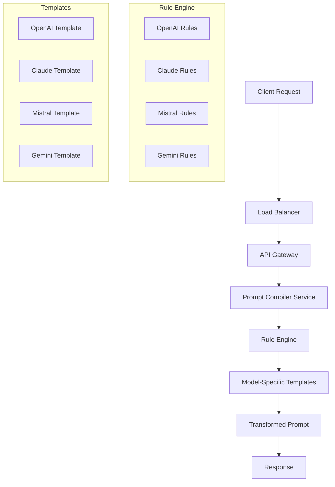
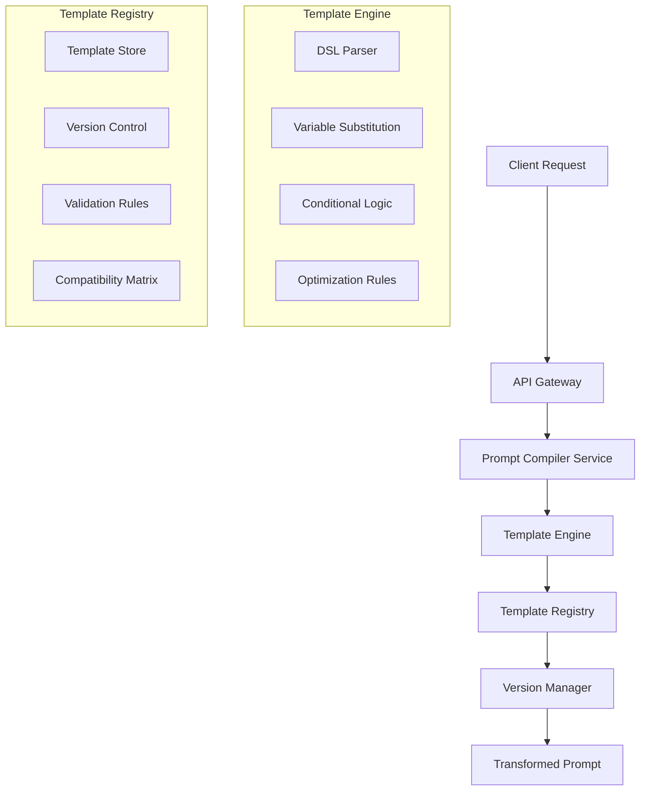
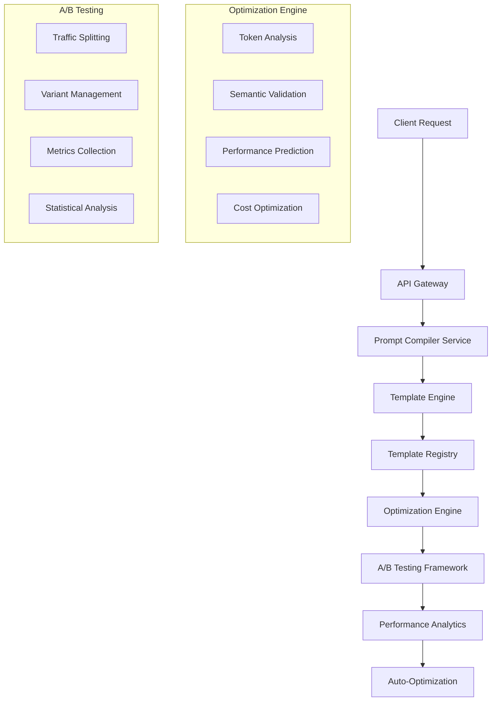
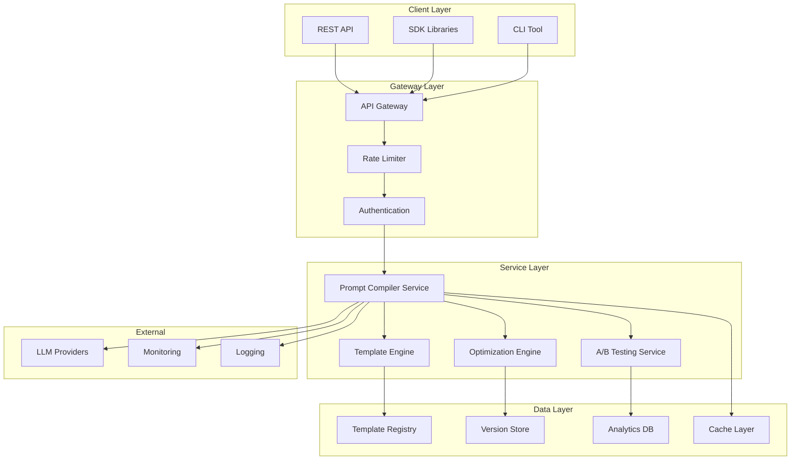
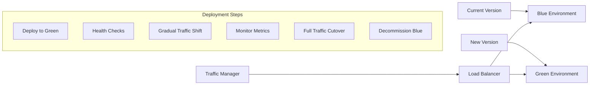
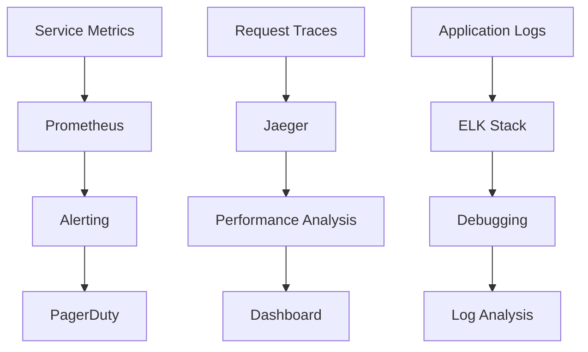
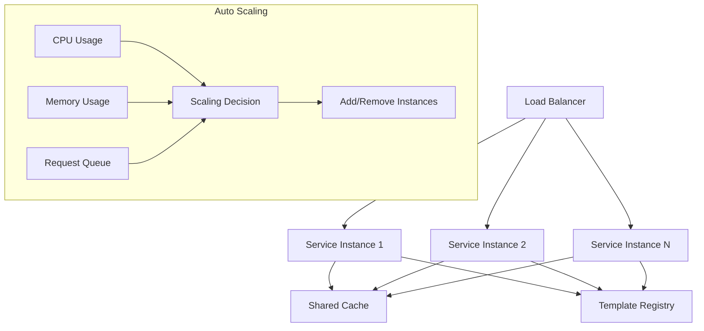
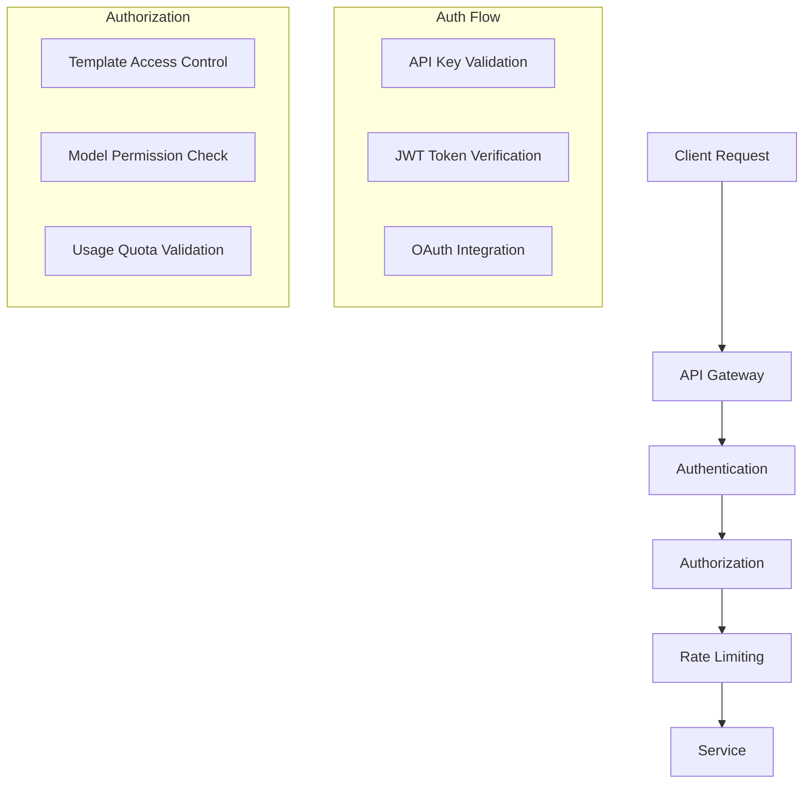

# Prompt-Adaptation Compiler Service: System Design

## Problem Statement

Modern AI applications need to interact with multiple LLM providers (OpenAI, Claude, Mistral, Gemini) simultaneously for redundancy, cost optimization, and model-specific capabilities. However, each provider has unique prompt syntax, formatting requirements, and optimization patterns. Manually maintaining separate prompt versions for each model is error-prone, time-consuming, and doesn't scale.

We need a service that automatically transforms a single canonical prompt into the optimal format for any target model while maintaining semantic equivalence and maximizing performance.

## P2: Requirements Analysis

### Functional Requirements
- Transform prompts from canonical format to model-specific syntax
- Support major LLM providers: OpenAI, Claude, Mistral, Gemini
- Maintain semantic equivalence across transformations
- Provide versioning and rollback capabilities
- Enable A/B testing of different prompt strategies
- Expose unified REST API and SDK interfaces
- Support zero-downtime deployments

### Non-Functional Requirements
- **Latency**: <50ms for prompt transformation (95th percentile)
- **Throughput**: 10,000 requests/second per instance
- **Availability**: 99.9% uptime
- **Accuracy**: 99.5% semantic preservation across transformations
- **Scalability**: Horizontal scaling with linear performance
- **Observability**: Full request tracing and metrics

## P3: Architecture Evolution

### Phase 1: Basic Transformation Engine

We start with a simple rule-based system that handles basic syntax differences:



**Why this approach?** Simple rule-based transformations are fast, predictable, and easy to debug. We can start with basic syntax differences like:
- System vs. Human vs. Assistant message formatting
- Role-based vs. instruction-based prompts
- Token limit optimizations
- Model-specific instruction patterns

**Why not ML-based approach initially?** While ML could learn optimal transformations, it introduces complexity, training overhead, and potential for semantic drift. Rule-based systems are more reliable for initial deployment.

### Phase 2: Template DSL and Versioning

As complexity grows, we need a structured way to define transformations:



**Template DSL Design:**
```yaml
template:
  name: "claude-3-opus-optimized"
  version: "1.2.0"
  target_model: "claude-3-opus"
  compatibility: ["claude-3-sonnet", "claude-3-haiku"]
  
  transformations:
    - type: "role_format"
      from: "system"
      to: "Human"
      condition: "model_supports_roles"
    
    - type: "instruction_optimization"
      pattern: "You are a helpful assistant"
      replacement: "You are Claude, an AI assistant"
      reasoning: "Claude-specific instruction improves performance"
    
    - type: "token_optimization"
      max_tokens: 4000
      strategy: "truncate_with_ellipsis"
      preserve: ["context", "examples"]
```

**Why YAML-based DSL?** YAML is human-readable, supports complex nested structures, and has good tooling support. JSON would be too verbose, and custom syntax would require building parsers from scratch.

**Versioning Strategy:**
- Semantic versioning (MAJOR.MINOR.PATCH)
- Backward compatibility within major versions
- Gradual rollout with feature flags
- Automatic rollback on error rate spikes

### Phase 3: Advanced Optimization and A/B Testing



**A/B Testing Framework:**
- Traffic splitting based on user ID, request ID, or percentage
- Multiple variants per template version
- Real-time metrics collection (latency, token usage, response quality)
- Statistical significance testing with confidence intervals
- Automatic promotion of winning variants

**Performance Optimization:**
- Token usage prediction and optimization
- Semantic similarity validation using embeddings
- Cost-aware transformations (prefer cheaper models when possible)
- Caching of frequently used transformations

## P4: Detailed Architecture

### Core Components



### Template DSL Specification

```yaml
# Core template structure
template:
  metadata:
    name: string
    version: string
    author: string
    created_at: timestamp
    updated_at: timestamp
  
  target:
    model: string
    provider: string
    version: string
    capabilities: [string]
  
  compatibility:
    models: [string]
    min_version: string
    max_version: string
  
  transformations:
    - type: transformation_type
      priority: integer
      condition: expression
      actions: [action]
  
  validation:
    semantic_check: boolean
    token_limit: integer
    required_fields: [string]
  
  optimization:
    strategy: string
    parameters: object
    fallback: object
```

**Transformation Types:**
1. **Role Formatting**: Convert between different role systems
2. **Instruction Optimization**: Model-specific instruction patterns
3. **Token Optimization**: Reduce token usage while preserving meaning
4. **Context Restructuring**: Reorganize context for better performance
5. **Example Formatting**: Adapt few-shot examples to model format
6. **Safety Filtering**: Apply model-specific safety constraints

### API Design

**REST Endpoints:**
```
POST /v1/compile
GET  /v1/templates
POST /v1/templates
PUT  /v1/templates/{id}
GET  /v1/versions/{template_id}
POST /v1/ab-test
GET  /v1/metrics
```

**Request/Response Schema:**
```json
{
  "request": {
    "prompt": "string",
    "target_model": "string",
    "template_version": "string?",
    "ab_test_id": "string?",
    "optimization_level": "basic|aggressive|cost_aware"
  },
  "response": {
    "transformed_prompt": "string",
    "template_used": "string",
    "version": "string",
    "token_estimate": "integer",
    "confidence_score": "float",
    "ab_test_variant": "string?",
    "metadata": "object"
  }
}
```

### SDK Interface

```python
class PromptCompiler:
    def compile(
        self,
        prompt: str,
        target_model: str,
        template_version: Optional[str] = None,
        optimization_level: OptimizationLevel = OptimizationLevel.BASIC,
    ) -> CompilationResult:
        pass

    def create_template(self, template: TemplateDefinition) -> Template:
        pass

    def ab_test(self, test_config: ABTestConfig) -> ABTestResult:
        pass
```

## Data Models

### Template Storage

```mermaid
erDiagram
    TEMPLATE {
        string id PK
        string name
        string version
        string target_model
        json definition
        timestamp created_at
        timestamp updated_at
        boolean active
    }
    
    TEMPLATE_VERSION {
        string id PK
        string template_id FK
        string version
        json definition
        timestamp created_at
        string created_by
        string change_log
    }
    
    COMPATIBILITY_MATRIX {
        string id PK
        string template_id FK
        string model_name
        string min_version
        string max_version
        boolean supported
    }
    
    AB_TEST {
        string id PK
        string template_id FK
        string name
        json variants
        float traffic_split
        timestamp start_time
        timestamp end_time
        string status
    }
    
    TEMPLATE ||--o{ TEMPLATE_VERSION
    TEMPLATE ||--o{ COMPATIBILITY_MATRIX
    TEMPLATE ||--o{ AB_TEST
```

## Deployment and Operations

### Zero-Downtime Deployment Strategy



**Deployment Process:**
1. **Blue-Green Deployment**: Deploy new version to separate environment
2. **Health Checks**: Validate service health and basic functionality
3. **Gradual Traffic Shift**: Move 5% → 25% → 50% → 100% traffic over 15 minutes
4. **Monitoring**: Watch error rates, latency, and business metrics
5. **Rollback**: Automatic rollback if error rate exceeds threshold

### Monitoring and Observability



**Key Metrics:**
- Request latency (p50, p95, p99)
- Error rates by template and model
- Token usage and cost per request
- A/B test performance metrics
- Template compilation success rate
- Cache hit rates

**Alerting Rules:**
- Error rate > 1% for 5 minutes
- Latency > 100ms for 10 minutes
- Template compilation failures > 5% for 2 minutes
- A/B test variant performance degradation > 20%

## P5: Scaling Strategy

### Horizontal Scaling



**Scaling Triggers:**
- CPU utilization > 70% for 5 minutes
- Memory usage > 80% for 3 minutes
- Request queue length > 100 for 2 minutes
- Error rate increase due to resource constraints

### Caching Strategy

**Multi-Level Caching:**
1. **Application Cache**: In-memory cache for frequently used templates
2. **Distributed Cache**: Redis cluster for shared template storage
3. **CDN Cache**: Static template definitions and SDK libraries

**Cache Invalidation:**
- Template updates trigger immediate invalidation
- Version-based cache keys for safe updates
- TTL-based expiration for stale data
- Background refresh for hot templates

## P7: Security Considerations

### Authentication and Authorization



**Security Measures:**
- API key authentication with scoped permissions
- JWT tokens for session management
- Rate limiting per client and endpoint
- Input validation and sanitization
- Audit logging for all operations
- Encryption at rest and in transit

## Cost Optimization

### Token Usage Optimization

**Strategies:**
1. **Smart Truncation**: Preserve important context while reducing tokens
2. **Template Optimization**: Use model-specific efficient patterns
3. **Caching**: Cache expensive transformations
4. **Batch Processing**: Group similar requests for efficiency

**Cost Monitoring:**
- Real-time token usage tracking
- Cost per request and per model
- Budget alerts and automatic throttling
- Cost-aware template selection

## P10: Follow-up Questions and Answers

### Q: How do you handle model-specific quirks and edge cases?

**A:** We implement a layered approach:
1. **Base Templates**: Handle common patterns across all models
2. **Model-Specific Overrides**: Address unique requirements per model
3. **Fallback Mechanisms**: Graceful degradation when optimizations fail
4. **Continuous Monitoring**: Detect and fix edge cases through real usage

### Q: What happens when a new model is released?

**A:** Our system is designed for extensibility:
1. **Template Versioning**: New models get new template versions
2. **Compatibility Matrix**: Automatic detection of model capabilities
3. **Gradual Rollout**: Test new templates with small traffic before full deployment
4. **Community Contributions**: Allow users to submit and test new templates

### Q: How do you ensure semantic equivalence across transformations?

**A:** Multiple validation layers:
1. **Embedding Similarity**: Compare semantic embeddings of original and transformed prompts
2. **Test Suite**: Comprehensive test cases for common prompt patterns
3. **Human Validation**: Sample review of transformations for quality assurance
4. **A/B Testing**: Measure actual performance differences in production

### Q: How do you handle prompt injection attacks?

**A:** Security-first approach:
1. **Input Sanitization**: Remove or escape potentially malicious content
2. **Template Validation**: Ensure templates don't contain executable code
3. **Sandboxing**: Isolate template execution environment
4. **Audit Logging**: Track all transformations for security analysis

### Q: What's your strategy for handling model API changes?

**A:** Robust change management:
1. **Version Pinning**: Lock to specific model versions for stability
2. **Compatibility Layer**: Abstract API differences behind our interface
3. **Gradual Migration**: Support multiple model versions during transitions
4. **Automated Testing**: Continuous integration with all supported models

## Conclusion

The Prompt-Adaptation Compiler Service provides a robust, scalable solution for managing prompt transformations across multiple LLM providers. By starting with simple rule-based transformations and evolving to a sophisticated template system with A/B testing and optimization, we create a service that:

- **Reduces Development Overhead**: Single prompt format for all models
- **Improves Performance**: Model-specific optimizations
- **Enables Experimentation**: A/B testing framework for continuous improvement
- **Ensures Reliability**: Zero-downtime deployments and comprehensive monitoring
- **Scales Efficiently**: Horizontal scaling with intelligent caching

The architecture prioritizes production readiness, operational excellence, and continuous improvement while maintaining the flexibility to adapt to new models and requirements as they emerge. 