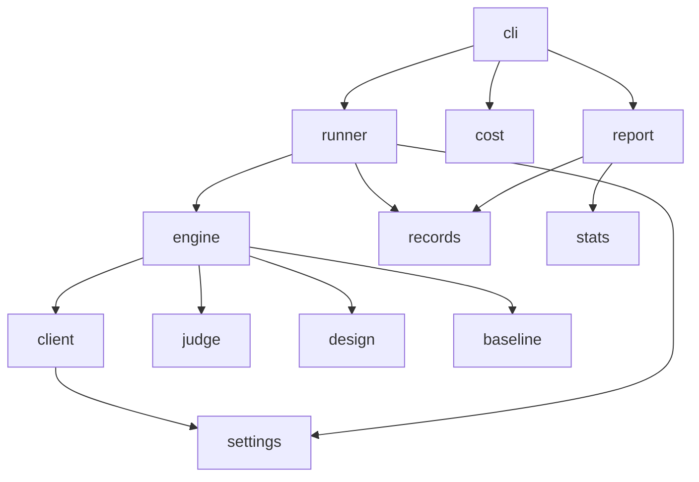

# Contributing

## Setup

```bash
uv sync --group dev
uv run pytest
uv run pre-commit run --all-files
```

Tests call the client through an `httpx2.MockTransport`. A live cycle is `tools/smoke.sh`, and it skips when `OPENROUTER_API_KEY` is unset.

## Changes

Use a short commit subject:

- `feat` adds a user-visible behavior.
- `fix` corrects a user-visible bug.
- `docs` changes documentation only.
- `refactor` changes structure without behavior.
- `test` changes the suite only.
- `chore` covers tooling and maintenance.

Add a model by passing `--model` or by changing the default tuple in `src/echochain/settings.py`. Add a condition in `src/echochain/design.py`, give it a schedule, and cover it from `tests/test_design.py`.

## Layers



## Release

1. Update `__version__` and `docs/CHANGELOG.md`.
2. Tag `vX.Y.Z` on `main`.
3. Publish the GitHub release. The release workflow builds the package and publishes it.

## Markdown

- Do not use an em dash, an en dash, or a spaced double hyphen.
- Put two or more items in a bullet list, and leave one item in the sentence.
- Keep a Mermaid label to three words and 24 characters, with no `\n` and no `end` node.
- Write README links as absolute `https://github.com/smusali/echoChain/blob/main/...` URLs.
- Keep a changelog entry to one sentence, one line, and 140 characters.
