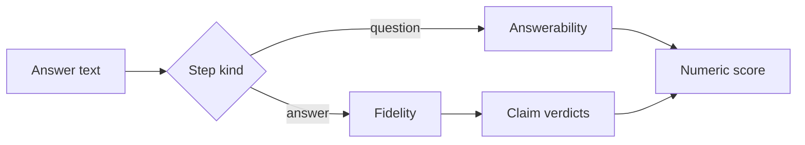

# Methodology

echoChain starts from a seed answer and asks models to rewrite it. Question steps turn an answer into a question. Answer steps turn that question back into an answer. A judge scores every step, and the run stops on a rule recorded in the manifest.

## Metrics

The judge scores answerability on a question step and fidelity on an answer step. Both use the prompt's 1 to 10 scale. An anchored score uses 1 to 5. When the seed lists claims, a fidelity step also records a supported or unsupported verdict for each claim. The row stores the score, the claim verdicts, and a comparison with the previous answer.

Length, token survival, and generic-word share are computed without a judge. With `baseline` set to `off`, a lexical scorer fills the comparison fields it can. With `baseline` set to `neural`, a pinned sentence-transformer model adds cosine similarity and an entailment score. A resumed run keeps the neural models recorded on its manifest.

## Conditions

The rotating conditions are `alternate`, `swap`, `factorial`, and `latin`. Each one assigns the configured models to steps through a fixed schedule. `fixed:<model>` sends every step to one model. The controls are `same-model`, `identity`, and `paraphrase`. Identity uses temperature 0 and scores fidelity on every step. Paraphrase asks for a same-length rewrite. `all` runs the controls together with `alternate`.

Two models that share a vendor family cannot sit in the same rotating set. The judge panel is a separate model list. A step can call the judge more than once. The mean is missing when a reply does not parse, and the run stops if those failures exceed `max_judge_error_share` of the planned steps.

## Analysis

`echochain analyze` reads finished run directories. It writes bootstrap curves of the score by step, a Kaplan-Meier curve of steps until the score stays at or below the threshold, the restricted mean of that time, and a log-rank comparison when more than one run is given. The attractor fit regresses the last score on the first when a group has enough runs and the absolute slope is below 1.

## Limitations

The score is a model judgment, not a fact check. A short chain can stop on the cycle cap before the threshold. Catalog prices can be missing, so a dry-run cost can be unknown. The lexical comparison does not measure meaning. The neural comparison depends on the pinned embedding and entailment models and is off unless requested.

## Built on

- Claim-level scoring, after FActScore (Min et al., EMNLP 2023).
- The telephone chain, after Mohamed et al. (ACL 2025) and Perez et al. (ICLR 2025), whose attractor fit `analyze` reports.
- Restricted mean survival time, after Royston and Parmar (BMC Medical Research Methodology, 2013).
