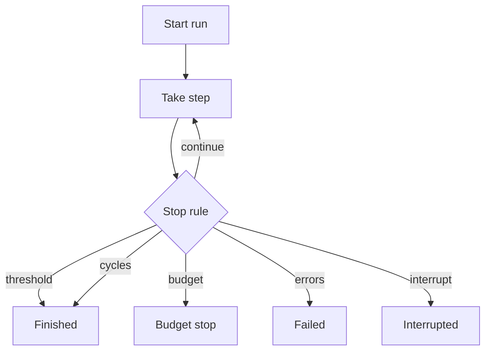

# Usage

echoChain is a command line tool. `echochain --start TEXT` is the same command as
`echochain run --start TEXT`.



## Commands

- `run` plans one cell, or a batch, and writes a run directory.
- `config show` prints the resolved settings.
- `models` checks the configured models against the OpenRouter catalog.
- `export RUN` prints a CSV table derived from `chain.jsonl`.
- `analyze RUN` writes tables and figures. Repeat `RUN` to compare runs, and pass `--out DIR` to choose the directory.

## Global flags

- `--config PATH` reads that TOML file instead of `./echochain.toml`.
- `--quiet` hides step progress.
- `--verbose` prints token counts and cost with each step.
- `--help` prints command help and does not need an API key.
- `--version` prints the package version and does not need an API key.

## Run flags

- `--start TEXT` is the inline seed text.
- `--seed ID` selects one seed from the seed file.
- `--seeds PATH` reads a seed file. With no `--seed`, every seed in that file runs.
- `--condition NAME` chooses a schedule. Repeat the flag to run several.
- `--repeats N` repeats each seed and condition pair.
- `--sampling-seed N` sets the base sampling seed.
- `--top-p N` sets the nucleus sampling cutoff.
- `--dry-run` prints call, token, and cost upper bounds and does not call a model.
- `--yes` starts a run whose dry-run cost is above `confirm_above_usd`.
- `--out DIR` is the directory that receives run folders.
- `--budget USD` stops the run at that cost.
- `--model ID` adds a rotating model. Repeat the flag to replace the default list.
- `--judge ID` adds a judge model. Repeat the flag to replace the default judge.
- `--judge-samples N` is the number of judge samples per step.
- `--judge-temperature N` is the judge temperature.
- `--temperature N` is the transform temperature.
- `--max-cycles N` is the number of planned steps.
- `--max-tokens N` is the completion token cap.
- `--stop-score N` is the low fidelity threshold.
- `--stop-consecutive N` is how many low scores stop a run. Zero means the threshold never stops the run.
- `--provider SPEC` pins a model to providers, as `model=provider,provider|true`.
- `--resume ID` continues a run id, a run directory, or a batch id.

`--start` cannot be combined with `--seed` or `--seeds`. A run with none of the three selectors is an error. `--seed` with no `--seeds` reads the packaged seed file. `--resume` cannot be combined with a new selector or with `--dry-run`.

## Configuration

Settings resolve in this order:

1. Built-in defaults.
2. `echochain.toml` in the working directory, or the file from `--config`.
3. Environment variables.
4. CLI flags.

These settings have no flag:

- `base_url` (`OPENROUTER_API_BASE`) is the OpenRouter API root.
- `deadline_seconds` (`ECHOCHAIN_DEADLINE_SECONDS`) is the per-call deadline.
- `confirm_above_usd` (`ECHOCHAIN_CONFIRM_ABOVE`) asks for `--yes` above this dry-run cost.
- `http_referer` (`ECHOCHAIN_HTTP_REFERER`) and `title` (`ECHOCHAIN_TITLE`) are request headers.
- `baseline` (`ECHOCHAIN_BASELINE`) is `off` or `neural`. The default is `off`.
- `max_judge_error_share` (`ECHOCHAIN_MAX_JUDGE_ERROR_SHARE`) stops the run when judge failures exceed this share of the planned steps. The default is `0.1`.

A TOML provider pin can also set `data_collection` to `allow` or `deny`, and `zdr` to true or false:

```toml
[providers."openai/gpt-4.1-mini"]
order = ["openai"]
allow_fallbacks = false
data_collection = "deny"
zdr = true
```

## Output

Each run is a directory under `--out`. The directory name is a UTC timestamp and a random id. The manifest stores a short slug, the seed text, the claims, and the rules used for that run.

- `manifest.json` is the run record, including `version`, `seed_text`, `claims`, and `max_judge_error_share`.
- `chain.jsonl` has one JSON object per step, including `input_text`, `output_text`, and `sampling_seed`.
- `BATCH.batch.json` stores the settings for a multi-cell run.
- `echochain analyze` writes `curves.tsv`, `survival.tsv`, `comparisons.tsv`, `curves.svg`, and `survival.svg`.

## Exit codes

- `0` means the cycle cap or the fidelity threshold was reached.
- `1` means a runtime or API failure, including a generation error or a judge error.
- `2` means a usage or configuration error.
- `3` means the budget was exceeded or the account is out of credits.
- `130` means the process was interrupted.

## Cost

`--dry-run` estimates calls, prompt tokens, and USD from catalog prices. When the estimate is above `confirm_above_usd`, the run waits for `--yes`. `--budget` stops a live run at a USD cap and exits `3`. A missing price makes the bound `unknown`.

## Resume

`--resume` rebuilds the run from `manifest.json`. It does not reread the seed file. The stored seed text, claims, models, temperatures, stop rule, and sampling seed stay in force. Client settings such as the API root and provider pins come from the current process. A manifest that recorded neural baseline models keeps those models. A run with no completed step resumes at step 1. An interrupted batch cell resumes from its own manifest, and a cell that never started uses the batch file.

## Data handling

Prompts and model replies are sent to OpenRouter and then to the selected providers. The API key is read from `OPENROUTER_API_KEY` or `.env` and redacted in logs, errors, and run files. Run files store the seed, the prompts' visible text, and the replies on disk under `--out`. Provider pins can set `data_collection` and `zdr` for a model. Fallbacks stay off unless a pin sets `allow_fallbacks` to true.
